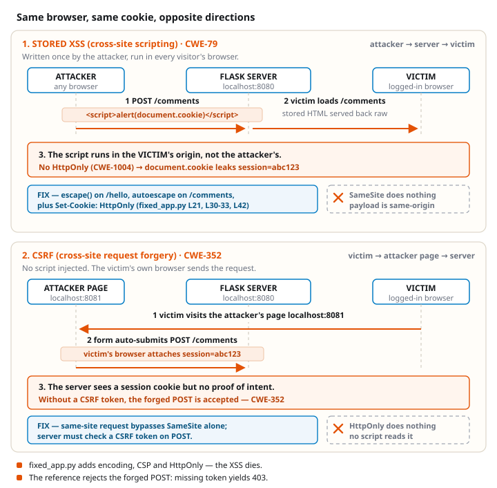

# Worksheet 5 — XSS and browser request controls

> Software Security 2 · KOSEN69 · Week 5 · OWASP 2025 **A05 Injection / CWE-79** (XSS) and **A01 Broken Access Control / CWE-352** (CSRF).

## Class contract

**150 minutes:** quiz/review 10, mechanism demo 15, common practical 100, debrief 20, save evidence 5. The task times below are planning budgets, not a student timing measurement. Prepare the lecture questions before class. Submit the common practical (60 points) and **one assigned format** (40 points): odd final student-ID digit = Conventional; even final digit, including 0 = AIR-Sec. Complete the assigned written format after class as needed. The other format and the extensions are optional reference practice. Check the live assignment for the exact deadline.

| Name | Student ID | Assigned format | Date |
|---|---|---|---|
| | | | |

**Authorized sandbox only.** Use the local lab and your own browser. `session=abc123` is a teaching value, never a real credential.

## Before class — concepts

1. Locate the reflected and stored XSS sinks in `vulnerable_app.py`. How is DOM XSS different?
2. Why does HTML text encoding stop `<script>`? Why would the same encoder be insufficient inside a JavaScript string or an untrusted URL?
3. What does CSP `script-src 'self'` add after output encoding?
4. What do `HttpOnly`, `SameSite`, and `Secure` control? Which protects a cookie from injected JavaScript, and which affects cookie attachment?
5. What does the same-origin policy stop an attacker page from **reading**? Does it stop that page from **submitting** an HTML form? Why can two localhost ports be different origins but the same site?

## Common practical — 100 minutes, 60 points

Build the image once while online, then the class can run without a package download:

```bash
cd labs/week05-xss-client-side
docker compose build
docker compose up --no-build --pull never
```

Open `http://localhost:8080/` first to set the sandbox session cookie. The app is bound to loopback only. Capture your own browser, terminal, and student ID together for evidence. In a second terminal, run `python3 -m http.server 8081 --bind 127.0.0.1` from this lab directory for Task 3. Both ports must be free.



```sim
xss-context
```

| Task | Minutes | Work and evidence |
|---|---:|---|
| 0. Baseline | 5 | Visit `/`, then `/hello?name=Alice` and `/comments`. Record the session cookie and a normal comment. |
| 1. Reflected XSS | 15 | In `/hello?name=`, try `<script>alert(1)</script>` and ``. Capture one execution and identify the HTML text sink. Count characters if you want the optional golf score. |
| 2. Stored XSS | 15 | Post `<script>alert(document.cookie)</script>` through the comment form; reload. Capture the script reading only the sandbox cookie. Explain why stored content can affect later visitors. |
| 3. Authenticated CSRF | 20 | While logged in at port 8080, visit `http://localhost:8081/csrf.html`. The page on a **different origin but the same site** submits a form to port 8080. Confirm the forged comment appears. Repeat in a fresh browser profile without first visiting port 8080: the POST must return 401 and add nothing. Record the request's Cookie header in DevTools, the response, and why missing-token validation permits the first request. |
| 4. Student patch and controls | 45 | Edit only `student_patch.py`: encode `render_name` and `render_comment` for an HTML text node; make `allow_post` require the sandbox session plus a nonempty token matching the server value. Run `docker compose run --rm xss-lab python student_checks.py`. Then restart with `docker compose run --rm --service-ports xss-lab python student_app.py`; repeat normal text, an XSS payload, a normal form POST, and `csrf.html`. The legitimate POST must work, scripts must render as text, and the forged POST must return 403. Show your changed lines and the browser results. |

The two localhost ports are **cross-origin** because port is part of origin, but **same-site** because site ignores port. Thus a SameSite cookie can accompany Task 3. The server must validate a token tied to the session. A cross-site `file://` attack page is **not** this exercise: modern browsers may withhold a default-Lax cookie from that POST.

To inspect the reference after your own patch, stop the current process and run:

```bash
docker compose run --rm --service-ports xss-lab python fixed_app.py
```

The reference uses output encoding, CSP and an unpredictable server token. It uses a hard-coded **sandbox** session and HTTP loopback; it is not a production login example. On HTTPS deployments set `Secure` on the cookie. CSP is defense in depth: once output is escaped, no script remains to trigger a CSP violation.

### Common practical scoring (60)

| Evidence | Points |
|---|---:|
| Baseline plus reflected/stored payloads, effect and sink explanation | 20 |
| Same-site, cross-origin forgery with cookie and no-session control | 15 |
| Student patch, normal and attack controls, explanation of encoding and token check | 25 |
| **Total** | **60** |

## Assigned Conventional format — 40 points

Answer in your own words using evidence from the common practical:

1. **XSS contexts (10):** Compare reflected, stored and DOM XSS; identify which two routes this app implements. Explain why escaping for HTML text is not a general URL or JavaScript string sanitizer.
2. **Browser boundaries (10):** Explain origin versus site using ports 8080/8081; distinguish same-origin policy, SameSite, HttpOnly and Secure.
3. **CSRF mechanism (10):** Explain why the request succeeds with a cookie and fails without one; why the token check stops it; and why an `Origin` check can add protection.
4. **Defense review (10):** Cite your patch lines and test output. Give one legitimate behavior that still works and one attack that fails. State the local sandbox's production limits.

## Assigned AIR-Sec format — 40 points

**Audit the AI (20):** Ask an AI assistant for an XSS and CSRF fix for this lab. Include its answer. Quote one incorrect or incomplete line, correct it, and verify the correction with your normal and attack controls. A claim that SameSite alone solves every CSRF case is a suitable flaw to investigate.

**Explain in plain English (10):** In 3–5 sentences explain why a comment can run as code and why a page on port 8081 can submit a request with the port-8080 session cookie.

**Prompt problem (10):** Write one precise prompt requesting an encoding and CSRF-token fix. Include your final prompt, the resulting code excerpt, and a before/after control result. Explain one limit of the generated answer.

## Optional extensions, no extra required points

- XSS Golf: minimize a payload while explaining its HTML context. A shorter string alone does not earn marks.
- Explore DOM XSS in an **optional** local target; this app has no DOM XSS sink.
- Show how `HttpOnly` changes `document.cookie` and why it does not stop page defacement by an injected script.
- Compare a cross-site attack page with the same-site port-8081 attack. Do not infer cookie attachment from a successful POST; inspect the Cookie request header.

## Evidence and submission

Submit the worksheet PDF on `learn.zcr.ai/submit` and your `student_patch.py` code link. Put a terminal showing your student ID and current date beside the browser in each screenshot. Include the exact payload, request/response or visible effect, and a short explanation of why the control works. Your instructor may ask you to reproduce a result. The live assignment states the due time and late policy.
