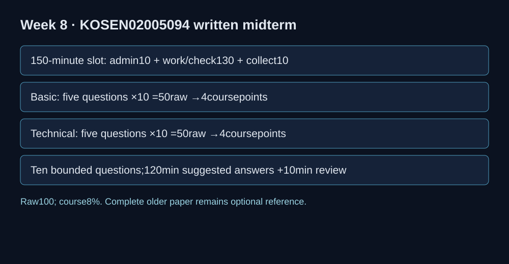

# Midterm written — current KOSEN specimen A

**Course: Software Security 2 (02005094) · Week 8 · 150-minute class slot: 10 minutes administration + 130 minutes working/checking + 10 minutes collection.**

**Raw 100: Basic 50 + Technical 50. Course weight: 8% (4 Basic + 4 Technical).** Covers Weeks 1–6.

Name: __________________ Student ID: ______________ Date: ___________

This public specimen fixes scope and workload. The instructor uses a separate prepared sitting variant. Answer only the ten questions below. Each is 10 raw points, with a suggested 12 minutes (120 minutes total), then use 10 minutes to review within the 130-minute working window. Administrative time is not additional task time. Use your own explanation and the provided sandbox/code only; permitted aids follow the published sitting notice. Precise mechanisms and tested-design reasoning matter more than memorized catalogue IDs.

## 1. B1 · Basic — 10 points, about 12 minutes

Identify two trust boundaries in browser → application → database. State one confidentiality and one integrity threat; name the appropriate STRIDE classes.

## 2. B2 · Basic — 10 points, about 12 minutes

Given an SQL concatenation finding, a leaked hard-coded token and an outdated dependency, choose SAST / secret scanning / SCA for each. Explain one blind spot of each scanner; distinguish a tool error from a clean result.

## 3. B3 · Basic — 10 points, about 12 minutes

Explain hashing versus encryption versus encoding. For password storage, state why an unsalted fast hash is insufficient and how a successful legacy login can trigger migration.

## 4. B4 · Basic — 10 points, about 12 minutes

Classify these defects and name a matching CWE: SQL string concatenation, raw untrusted HTML text, disabled JWT verification, and missing order ownership checks. State the affected boundary for two.

## 5. B5 · Basic — 10 points, about 12 minutes

Explain authentication versus authorization, least privilege and fail closed. Give one legitimate positive control and one negative control for an owner-only order endpoint.

## 6. T1 · Technical — 10 points, about 12 minutes

A login uses SELECT id FROM users WHERE name='<input>' AND password='<hash>'. In this isolated teaching scenario, explain one boolean-bypass input and why it changes the query. Replace the query with placeholders and bound values; give one negative and one legitimate positive test.

## 7. T2 · Technical — 10 points, about 12 minutes

A diagnostic route runs a shell command assembled from a user-supplied host. Write a design using an argv list, no shell, an IPv4 parser/allowlist and a timeout. Explain why filtering only semicolons is insufficient; give allowed and rejected inputs.

## 8. T3 · Technical — 10 points, about 12 minutes

A page returns <h1>Hello {name}</h1>. Show a correction for this HTML text context. Explain what an HttpOnly cookie changes and what it does not prevent. Give one normal-name test and one XSS-string test.

## 9. T4 · Technical — 10 points, about 12 minutes

A JWT is decoded with verify_signature=False, then its sub selects an order. Specify pinned algorithm/key, required claims, audience/expiry verification, and owner authorization. Give tests for an owner token, another user, and an invalid token.

## 10. T5 · Technical — 10 points, about 12 minutes

A legacy MD5 record is successfully checked at login. Show the Argon2id record update at that point and explain why a failed login must not change it. Describe a safe staged migration and a test showing that the next correct login still works.

The earlier paper is archived in the course source for optional reference. Its former timings, sections and mark allocation do not apply to this specimen.
