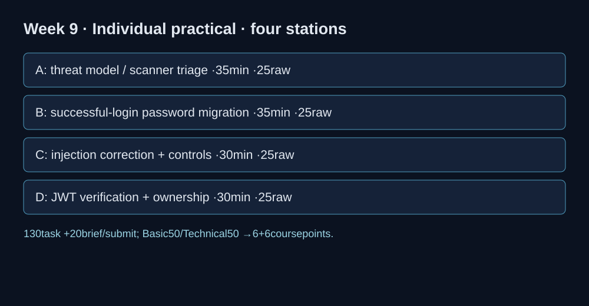

# Midterm individual practical — current KOSEN assessment

**02005094 · Week 9 · 150-minute slot: briefing10 + bounded tasks130 + submission10.**

**Raw 100 · Basic 50 / Technical 50 · course contribution 12%. Individual.** Only the four stations below are required. Course marks use the fixed rubric, independent of CTFd dynamic scores, first-blood, prizes or House XP. A flag alone does not demonstrate correction and cannot earn full academic marks.

The instructor supplies a preflighted local examination pack with the selected starters, data and dependency/runtime instructions. Public weekly labs are practice, not personalized examination evidence; fresh exam flags/instances are not claimed to be deployed. If a supplied hosted instance is used, its proof must come from the assigned instance, but the correction and control evidence below still applies. Never attack an external system.

## Station A — Threat model and scanner triage: 25 raw points, 35 minutes

**Scope:** W1/W2.

Read the supplied browser/application/database scenario and two scanner findings. Mark the boundary and prioritize the real issue versus the false positive. Identify a tool-error output as an unsuccessful scan. Propose the specific control and one legitimate plus one negative validation case.

**Submit:** DFD/triage sheet; observed scan status; corrected code/design and both control expectations.

## Station B — Password record migration: 25 raw points, 35 minutes

**Scope:** W3.

In the supplied migrate.py starter, complete the successful-login rehash update. Demonstrate wrong-password denial without a record change; successful migration to Argon2id; next correct login still succeeds. Explain why you cannot bulk-upgrade a hash without a password.

**Submit:** Student diff and three observed state/verification checks.

## Station C — Injection control: 25 raw points, 30 minutes

**Scope:** W4.

Complete the provided parameterized SQL and validated IPv4 argv functions. Keep one ordinary lookup/IPv4 case working; reject an injection string and a shell-metacharacter host without executing a shell.

**Submit:** Student patch and observed positive/negative test outputs.

## Station D — Authenticated object ownership: 25 raw points, 30 minutes

**Scope:** W6.

Complete pinned JWT verification with required sub/aud/exp and a server-side order ownership decision. Demonstrate owner success, cross-user denial and malformed/unsigned token denial.

**Submit:** Student patch and observed owner/forgery/access-control tests.

## Fixed marking and conversion

Each station: **Basic 12.5** = correct observation/root cause5 + mechanism/boundary reasoning5 + evidence interpretation/limits2.5; **Technical 12.5** = student-authored correction5 + legitimate/negative controls5 + reproducible execution evidence2.5. Four stations give Basic 50+Technical 50=raw 100. Course contribution = Basic raw/50×6 + Technical raw/50×6 = at most12. Partial credit follows demonstrated criteria; a flag or copied reference patch alone is insufficient.

## Submission

Submit one evidence bundle per student (midterm) or existing team (final): station ID, changed source/diff, exact command, observed result, legitimate positive control, negative control, mechanism and remaining limits. Use the actual sitting assignment announced by the instructor; this update does not silently repurpose historical MFU assignment #16 or change old grades. Verify upload within the final10minutes; no extra task work is scheduled then.

The complete earlier challenge sheet remains archived in the course source for optional practice. Its old challenge count, hash-cracking/ECB tasks, raw totals and flag-only submission rule are superseded for this KOSEN sitting.
