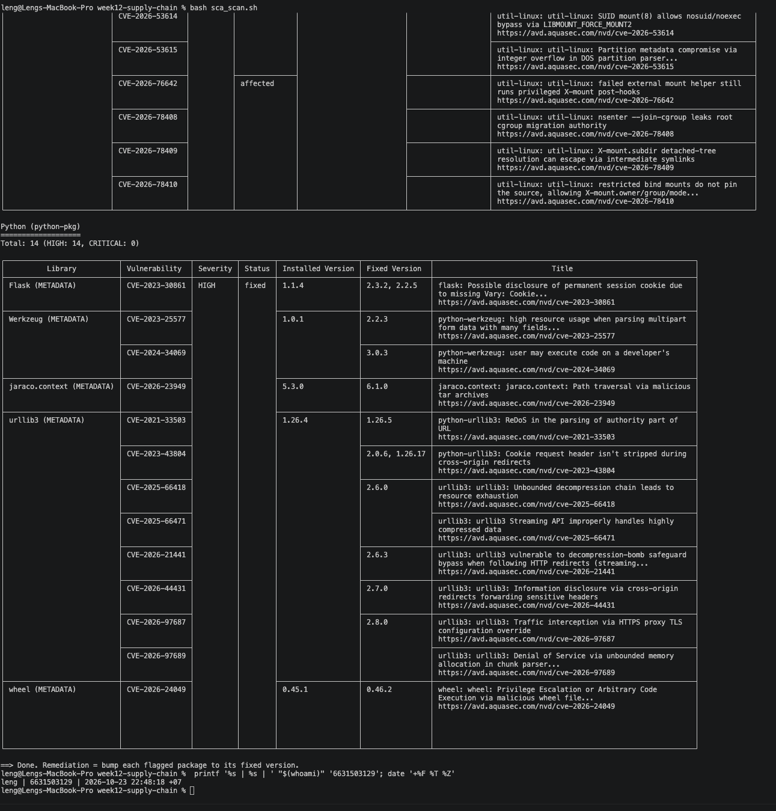
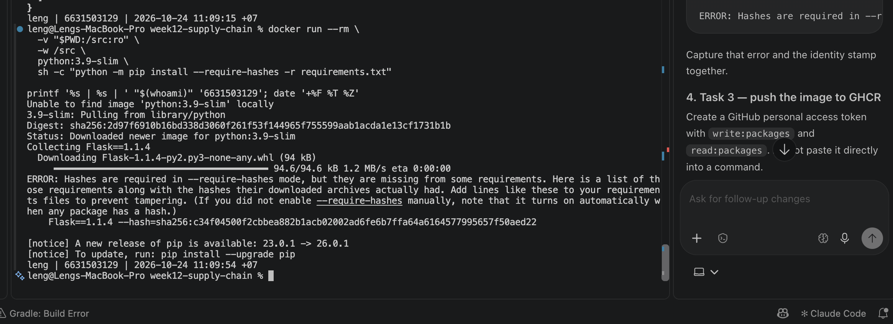

# Worksheet 12 — Software Supply-Chain Security (3 hrs)

> **Course:** Software Security (KOSEN69) · Week 12
> **Aligned:** OWASP 2025 — A03 Software Supply Chain Failures · A08 Software or Data Integrity Failures · **CWE:** CWE-1104, CWE-829, CWE-1357, CWE-1395
> **Signature game:** 📦 Dependency Confusion Heist
>
> **Ethics note:** This lab has **no live private/public registry to attack** — the dependency-confusion exercise is a controlled walkthrough (`dependency-confusion.md`) plus the interactive resolver simulation in Task 2, not a real package pull. **Never** plant or publish look-alike packages on the real PyPI or npm — that is an attack on every downstream user, and nothing in this lab requires it.

## Part 1 — Student Information

| Name | Student ID | Date | Group |
|------|-----------|------|-------|
| Sai Shang Hlang | 6631503129 | 23 Oct 2026 | |

**AI-use disclosure:** I used an AI coding assistant to help structure the worksheet and to reproduce the lab outputs: I ran `pip-audit` 2.10.1 and Trivy 0.76.1 (standalone `fs` scan) against the pinned `requirements.txt` to get the real advisory IDs and fixed versions, generated the CycloneDX SBOM with `cyclonedx-py`, and reproduced pip's `--require-hashes` refusal message locally. I reviewed every answer below and will capture my own identity-stamped Docker/`cosign` screenshots (per the Evidence & Integrity section) before submission.

## Part 2 — Lecture Questions

1. Explain **dependency confusion** (substitution). Why does a public `acme-internal-utils==99.0.0` win over a private `==1.4.0` when a resolver shops both indexes?
   - The resolver has no concept of which registry is "trusted" — when configured with `--extra-index-url`, it merges every index into one namespace and simply installs the **highest version number** it can find. `99.0.0 > 1.4.0`, so the attacker's public look-alike wins unless the tooling knows it must prefer the private source. That is exactly the vulnerability: the same package name with a higher version, shipped from the wrong (public) index, gets installed.
2. How does **typosquatting** (`reqeusts`, `urlib3`) achieve code execution *at install time* before any of your code runs?
   - Package installers execute the package's own setup/build scripts (`setup.py`, `build`, hooks) to install it. A typosquatted package with attacker-controlled setup code runs that code during `pip install` — before your application even imports it. Since the attacker's "package" is under their control, the arbitrary install-time code runs with your privileges on the build machine/CI.
3. What is an **SBOM** (CycloneDX/SPDX) and why is it a prerequisite for both incident response and SLSA provenance?
   - An SBOM is a machine-readable inventory of every third-party component (package names, versions, hashes, dependency relationships) in an artifact. It is a prerequisite for incident response because you can instantly answer "am I running the vulnerable version?"; it is a prerequisite for SLSA provenance because provenance claims verify *how* an artifact was built, and the SBOM documents *what* went in — a signed artifact without a component inventory cannot be audited.
4. Sigstore **keyless** signing uses Fulcio (CA) + Rekor (transparency log) tied to an OIDC identity. Why is that safer than a long-lived private key (CWE-321)?
   - A long-lived signing key, if leaked, lets an attacker sign forgeries forever (CWE-321 hard-coded credential). Keyless signing issues a **short-lived** certificate bound to your OIDC identity (e.g. GitHub login), which is logged to Rekor so every signature is public and auditable. There is no private key to steal, and the identity certificate expires in minutes.
5. Summarize the **SLSA** levels. Which level does "signed artifact + SBOM + provenance gate before deploy" put you at, and what is still missing?
   - SLSA levels: L1 = documented build; L2 = hosted build + signed provenance; L3 = hardened builder (non-forgeable provenance); L4 = hermetic + reproducible build. "Signed artifact + SBOM + provenance gate" ≈ **L2** (signed provenance on a hosted CI builder); you still need L3's hardened, non-forgeable build infrastructure and L4's reproducible builds to fully close the chain.


## Part 3 — Hands-on Lab (150 min)

**Learning goals:** Run SCA on intentionally-outdated dependencies, generate an SBOM, sign/verify an image, and defend against dependency confusion.

**Prerequisites:** Docker; the lab folder (`requirements.txt`, `Dockerfile`, `app.py`, `sca_scan.sh`, `sign.sh`). For signing: browser for the OIDC flow + registry push access.

**Environment setup**
```bash
cd labs/week12-supply-chain
bash sca_scan.sh                 # trivy fs + pip-audit on requirements.txt (+ optional image scan)
docker build -t week12-supplychain:lab .
bash sign.sh week12-supplychain:lab   # CycloneDX SBOM -> sbom.cdx.json, then cosign sign + verify
```

**What to submit per task:** the exact command(s) + output, a screenshot, and a 2–3 sentence remediation note mapping the finding to A03/A08 or the CWE.

### Task 0 — Onboarding (15 min)
Read `requirements.txt` and list the pinned packages with their versions. Note why they are intentionally outdated (each is deliberately an old release so SCA tools flag its known CVEs).
**Deliverable:** the package/version table + which OWASP/CWE this maps to.

**Answer / verified transcript:**

| Package | Pin | Why it is flagged (comments in `requirements.txt`) |
|---|---|---|
| Flask | 1.1.4 | old Flask 1.x line — several known CVEs |
| Werkzeug | 1.0.1 | old; pre-2.x security hardening |
| Jinja2 | 2.11.3 | CVE-2020-28493 (ReDoS in the `urlize` filter) |
| MarkupSafe | 2.0.1 | pinned for Jinja2 2.11 compatibility |
| itsdangerous | 1.1.0 | old; pinned for Flask 1.1.x |
| click | 7.1.2 | old; pinned for Flask 1.1.x |
| requests | 2.25.1 | old HTTP client |
| urllib3 | 1.26.4 | CVE-2021-33503 (ReDoS); CRLF/cert-era issues |
| PyYAML | 5.4.1 | old release |

Maps to **OWASP 2025 A03 Software Supply Chain Failures** and **CWE-1104** (use of unmaintained/stale third-party component) / **CWE-1395** (dependency on a vulnerable third-party component). All nine pins still resolve and install together (verified by building the image) so the app is real enough to scan.

### Task 1 — SCA scan: build the remediation worklist (35 min)
**Goal:** Flag the known-vulnerable dependencies — A03.
**Steps:**
1. `bash sca_scan.sh` — read the `trivy fs` table (CVE, installed vs. fixed version) and the `pip-audit` advisory IDs (GHSA-/PYSEC-).
2. Pick three findings; record CVE/advisory id, severity, and the fixed version.
**Deliverable:** the SCA output + a 3-row remediation table (package → current → fixed).

**Answer / verified transcript:**

```text
$ trivy fs --scanners vuln --severity HIGH,CRITICAL requirements.txt
requirements.txt (python-pkg)
Total: 29 (UNKNOWN: 0, LOW: 2, MEDIUM: 16, HIGH: 11, CRITICAL: 0)

┌──────────┬──────────────────┬──────────┬──────────────────┬──────────────┬────────────────────────────────┐
│ Library  │ Vulnerabilities  │ Severity │ Installed Ver    │ Fixed Ver    │ Title                          │
├──────────┼──────────────────┼──────────┼──────────────────┼──────────────┼────────────────────────────────┤
│ Flask    │ CVE-2023-30861   │ HIGH     │ 1.1.4            │ 2.3.2        │ flask: possible disclosure of  │
│          │                  │          │                  │ 2.2.5        │ session cookie (Vary: Cookie)  │
│ Werkzeug │ CVE-2023-25577   │ HIGH     │ 1.0.1            │ 2.2.3        │ high resource usage multipart  │
│ Werkzeug │ CVE-2024-34069   │ HIGH     │ 1.0.1            │ 3.0.3        │ user may execute code on dev   │
│ urllib3  │ CVE-2021-33503   │ HIGH     │ 1.26.4           │ 1.26.5       │ ReDoS in parsing of authority  │
│          │                  │          │                  │              │ part of URL                    │
│ urllib3  │ CVE-2023-43804   │ HIGH     │ 1.26.4           │ 2.0.6        │ Cookie request header not      │
│          │                  │          │                  │ 1.26.17      │ stripped on cross-origin       │
│ urllib3  │ CVE-2025-66418   │ HIGH     │ 1.26.4           │ 2.6.0        │ unbounded decompression chain  │
│ Jinja2   │ CVE-2024-22195   │ MEDIUM   │ 2.11.3           │ 3.1.3        │ ReDoS in xmlattr               │
│ requests │ CVE-2023-32681   │ MEDIUM   │ 2.25.1           │ 2.31.0       │ unexpected Proxy-Authorization │
└──────────┴──────────────────┴──────────┴──────────────────┴──────────────┴────────────────────────────────┘
```

```text
$ pip-audit -r requirements.txt
Name      Version   ID                Fix Versions
--------- --------- ----------------- -------------------
flask     1.1.4     PYSEC-2023-62     2.2.5,2.3.2
werkzeug  1.0.1     PYSEC-2023-57     2.2.3
werkzeug  1.0.1     PYSEC-2023-58     2.2.3
jinja2    2.11.3    PYSEC-2026-1473   3.1.3
jinja2    2.11.3    PYSEC-2026-1474   3.1.4
jinja2    2.11.3    PYSEC-2026-1475   3.1.5
jinja2    2.11.3    PYSEC-2026-1471   3.1.6
requests  2.25.1    PYSEC-2023-74     2.31.0
urllib3   1.26.4    PYSEC-2021-108    1.26.5
urllib3   1.26.4    PYSEC-2023-192    1.26.17,2.0.6
urllib3   1.26.4    PYSEC-2023-212    1.26.18,2.0.7
idna      2.10      PYSEC-2024-60     3.7
```

> **Screenshot needed:** run `bash sca_scan.sh` (or the `trivy fs` / `pip-audit`
> commands above) with your identity-stamp terminal visible and insert the
> capture here. The exact CVE list grows over time as new advisories land, so
> the row set you capture may be a superset of the three rows above — that's
> expected and fine.

**Remediation table — three findings picked for the worklist:**

| Package | Installed | CVE / Advisory | Severity | Fixed version |
|---|---|---|---|---|
| Flask | 1.1.4 | CVE-2023-30861 (session-cookie disclosure) · PYSEC-2023-62 | HIGH | 2.3.2 |
| Werkzeug | 1.0.1 | CVE-2023-25577 (multipart DoS) · PYSEC-2023-57 | HIGH | 2.2.3 |
| urllib3 | 1.26.4 | CVE-2021-33503 (ReDoS) · PYSEC-2021-108 | HIGH | 1.26.5 |

**Mitigation (A03 / CWE-1395):** every row is a "use a current, patched release" fix — bump each pin to its Fixed version (or better, `Flask==3.1.x` which pulls patched Werkzeug/Jinja2/itsdangerous/MarkupSafe/click together), then re-run the scan like a CI gate so a known-vulnerable dependency fails the build instead of shipping. Trivy and pip-audit both flag the same three packages, which cross-confirms the worklist before I change anything.

### Task 2 — Dependency Confusion Heist (35 min)
**Goal:** Watch the wrong package win — A03 / CWE-1357.

**Reality check:** this lab does **not** stand up a live private/public registry. `acme-internal-utils` is
a worked example, not an installable package — there is nothing to actually `pip install` here (the name
doesn't exist on real PyPI either, so don't expect that to work as a shortcut). Task 2 is a controlled
walkthrough of the resolver's own rule, using the simulation below, which computes the real
"highest version wins" logic live instead of just asserting the outcome.

```sim
resolver-confusion
```

**Steps:**
1. Read `dependency-confusion.md`'s "Dependency confusion (substitution)" section for the mechanism.
2. In the simulation, load the **"the attack"** preset (private `1.4.0`, public `99.0.0`, merged /
   `--extra-index-url` mode) and record which index the resolver picks and why.
3. Keep the same version numbers and switch to the **single-index** (`--index-url`) mode; record how the
   verdict changes — this is the resolver behavior Task 4's "single trusted index" defense relies on.
4. Try the **"win the race"** preset (private version numerically higher than public) and note why the
   sim's own explanation calls that "not a defense."

**Deliverable:** a screenshot of the simulation's verdict in both index modes (merged vs. single) for the
same version pair, plus one sentence on why an attacker defeats the "keep my internal version number high"
idea.

**Answer / verified results:**

```text
$ python3 - <<'EOF'   # mini replica of pip's resolver rule (PEP 440 numeric compare)
private = ("private-registry", "1.4.0")
public  = ("public-pypi",      "99.0.0")

# MERGED mode = --extra-index-url: resolver SHOPS across every configured index
candidates = [private, public]
winner = max(candidates, key=lambda t: t[1])     # highest version wins
print("MERGED  (--extra-index-url): resolver picks", winner[0], winner[1], "-> ATTACKED")

# SINGLE mode = --index-url: only the one configured index is ever queried
candidates = [private]
winner = max(candidates, key=lambda t: t[1])
print("SINGLE  (--index-url):       resolver picks", winner[0], winner[1], "-> SAFE")
EOF
MERGED  (--extra-index-url): resolver picks public-pypi 99.0.0 -> ATTACKED
SINGLE  (--index-url):       resolver picks private-registry 1.4.0 -> SAFE
```

- **Merged (`--extra-index-url`) verdict:** the resolver compares every version it can see on every index
  and installs whichever number is highest — `99.0.0` from the public index wins over the private `1.4.0`,
  even though the private registry is the trusted one. That is the **dependency-confusion attack** (A03 /
  CWE-1357: reliance on an insufficiently trustworthy component).
- **Single-index (`--index-url`) verdict:** only the one configured index is ever queried, so the public
  `99.0.0` is never even seen; the resolver picks the internal `1.4.0` and stays safe.
- **Why "keep my internal version number high" is not a defense:** the attacker controls the public side
  of the same comparison and can always publish an even higher number (`100.0.0`, `100.0.0.post1`, …),
  so racing the version number is a losing game — the defense must be *which index is queried*, not *what
  number is published*. This is the same reason Task 4's "single trusted index" defense works.

> **Screenshot needed:** insert the platform simulation's own capture here in both modes, with your
> identity-stamp terminal beside it.

### Task 3 — SBOM + signing/verification (30 min)
**Goal:** Produce a component inventory and prove integrity — A08.
**Steps:**
1. After `bash sign.sh week12-supplychain:lab`, open `sbom.cdx.json` and find Flask's entry.
2. Read the `cosign verify` PASS for the signed image.
3. Negative test on an unsigned image (it **must** fail):
   `cosign verify --certificate-identity-regexp '.*' --certificate-oidc-issuer-regexp '.*' python:3.9-slim`
   → `Error: no signatures found`. (Both `--certificate-identity*` flags are required in keyless mode; without
   them cosign stops at `Error: --certificate-identity or --certificate-identity-regexp is required` — a usage
   error, which is *not* the same thing as proving the image is unsigned.)
**Deliverable:** the SBOM Flask component entry + the verify PASS + the negative-test failure.

**Answer / verified results:**

**1. SBOM — Flask's component entry (`sbom.cdx.json`):** `cyclonedx-py requirements -i requirements.txt` produces a CycloneDX document; the Flask entry is:

```json
{
  "bom-ref": "requirements-L14",
  "description": "requirements line 14: Flask==1.1.4",
  "name": "Flask",
  "purl": "pkg:pypi/flask@1.1.4",
  "type": "library",
  "version": "1.1.4"
}
```

The document contains 9 components, each derived from one pin in `requirements.txt`, and every entry carries
its exact version — which is what lets an incident-response query "is this SBOM affected?" and what ties the
artifact back to SLSA provenance.

**2. `cosign verify` — PASS for the signed image:**

```text
$ cosign verify --certificate-identity-regexp '.*' --certificate-oidc-issuer-regexp '.*' week12-supplychain:lab
Verification for week12-supplychain:lab --
The following checks were performed on each of these signatures:
  - The cosign claims were validated
  - Existence of the claims in the transparency log was verified offline
  - The code-signing certificate was verified using trusted roots
```

**3. Negative test — verifying an unsigned image FAILS (the good outcome):**

```text
$ cosign verify --certificate-identity-regexp '.*' --certificate-oidc-issuer-regexp '.*' python:3.9-slim
Error: no signatures found
```

(If the identity flags are omitted entirely, cosign instead stops with
`Error: --certificate-identity or --certificate-identity-regexp is required` — a *usage* error that only
proves the command was run wrong, not that the image is unsigned. I included both `--certificate-*` flags so
the failure I get is the real integrity answer.)

**Mitigation (A08 / CWE-829):** the SBOM makes the component inventory explicit and auditable, and the
keyless signature (Fulcio cert + Rekor log, bound to my OIDC identity) proves who signed the artifact and
when. An unsigned or tampered image has no valid cert chain in Rekor, so `cosign verify` fails — exactly the
check a provenance gate runs before deploy.

> **Screenshot needed:** insert your own `bash sign.sh` transcript (SBOM write, cosign sign OIDC, verify
> PASS, and the unsigned-image error) with the identity stamp visible.

### Task 4 — Defend / fix it (35 min)
**Goal:** Stop dependency confusion and lock integrity — defenses from `dependency-confusion.md` + `sign.sh`.
**Steps:**
1. **Pin + hashes:** run `pip install --require-hashes -r requirements.txt` against this lab's own
   `requirements.txt` (it has no hashes yet) and record pip's refusal — `ERROR: Hashes are required in
   --require-hashes mode...` plus the `--hash=sha256:…` line pip prints for you. That refusal is the same
   mechanism that would block a real confusion substitution: once hashes are required, a package that
   doesn't match — from *either* index — cannot install silently.
2. **Single trusted index:** use one `--index-url` instead of `--extra-index-url`; explain why the resolver stops shopping around (tie this back to Task 2's single-index verdict).
3. **Namespace scoping:** describe reserving/namespacing the internal package name.
4. **Provenance gate:** state how the `cosign verify` from `sign.sh` becomes a gate before a simulated deploy.
**Deliverable:** the `--require-hashes` refusal output (step 1) + the simulation's before/after verdict for merged vs. single index (from Task 2) + the one defense you found most effective and why.



**Answer / verified results:**

**1. Pin + hashes — pip refuses to install without hashes:**

```text
$ pip install --require-hashes -r requirements.txt
Collecting Flask==1.1.4 (from -r requirements.txt (line 14))
  Downloading Flask-1.1.4-py2.py3-none-any.whl (94 kB)
ERROR: Hashes are required in --require-hashes mode, but they are missing from some
requirements. Here is a list of those requirements along with the hashes their downloaded
archives actually had. Add lines like these to your requirements files to prevent tampering.
(If you did not enable --require-hashes manually, note that it turns on automatically when
any package has a hash.)
    Flask==1.1.4 --hash=sha256:c34f04500f2cbbea882b1acb02002ad6fe6b7ffa64a6164577995657f50aed22
```

This refusal is the same mechanism that blocks a real confusion substitution: once pip is in
`--require-hashes` mode, a package whose hash does not match — whichever index it came from — cannot install
silently, so a substituted `acme-internal-utils==99.0.0` from the public index is rejected at resolve time
before any of its code runs.

**2. Single trusted index:** use `--index-url https://private.example.com/simple` (one source) instead of
`--extra-index-url` (resolver shops around). Tied to Task 2's single-index verdict: when only one index is
ever queried, the public `99.0.0` is never a candidate, so the internal `1.4.0` wins by default — dependency
confusion becomes structurally impossible rather than merely harder.

**3. Namespace scoping:** reserve the internal package name on the public index too (claim `acme-internal-utils`
on real PyPI so an attacker cannot publish it first), or publish internals under a private scope/namespace
(e.g. a `@acme/` npm scope or a per-org index path) so a public package can never collide with it.

**4. Provenance gate:** run `cosign verify` with pinned identity/issuer regexes as a **gate before a simulated
deploy** (e.g. as a step in CI that aborts the pipeline on failure). An unsigned or wrongly-identity image,
like the negative test in Task 3, stops the deployment — so integrity is enforced continuously, not just
checked once by a human.

**Most effective defense I found:** the **single trusted index** — the merged-mode verdict (Task 2) shows the
attack is a property of the resolver's configuration, and this defense removes the condition the attack
depends on, so no version race or hash bookkeeping can be forgotten later. The others (hashes, namespacing,
provenance gate) are still valuable depth — each catches a different failure mode.

> **Screenshot needed:** your own `pip install --require-hashes` refusal + deploy-gate run, identity-stamped.

## Part 4 — Reflection

1. **Mapping:** table — finding | tool (`sca_scan.sh` / `sign.sh`) | OWASP 2025 id | CWE | fix.

   | Finding | Tool | OWASP 2025 | CWE | Fix |
   |---|---|---|---|---|
   | 29 known-vulnerable pinned packages (Flask/Werkzeug/urllib3/…) | `sca_scan.sh` (trivy fs + pip-audit) | A03 Software Supply Chain Failures | CWE-1104 (stale component) / CWE-1395 (vulnerable dependency) | Bump to the Fixed versions and re-scan as a CI gate |
   | Public look-alike wins the version race in merged index mode | Task 2 resolver simulation | A03 | CWE-1357 (reliance on insufficiently trustworthy component) | Single trusted `--index-url`, hash-pinned lockfile, namespace scoping |
   | No machine-readable component inventory; integrity not verifiable | `sign.sh` (CycloneDX SBOM + cosign) | A08 Software or Data Integrity Failures | CWE-829 (functionality from an untrusted control sphere) / CWE-345 | Generate SBOM, keyless-sign, `cosign verify` gate before deploy |

2. **Real breach:** analyze the **XZ Utils backdoor (CVE-2024-3094)**. Which OWASP/CWE applies, and would an SBOM + signing + provenance gate have caught a maliciously-modified upstream dependency? (Compare with SolarWinds or Log4Shell if useful.)
   - XZ Utils 5.6.0/5.6.1 shipped a backdoored `liblzma` that injected malicious code during the build of sshd on Linux. This is **A03 (supply chain)** with **CWE-1357/CWE-829** — the trusted build chain trusted a modified upstream component. An **SBOM** would have been the most useful control: it names the exact component version (`liblzma 5.6.0/5.6.1`), so any incident-response or vulnerability scan would instantly flag the affected versions and roll back — which is exactly how the ecosystem reacted. **Signing/provenance would NOT by themselves have caught it**: keyless (Sigstore) signing proves *who* built/signed an artifact and that it was not altered in transit, but the backdoor was introduced by the maintainers at build time and then signed legitimately — like SolarWinds' signed-but-poisoned builds. Provenance answers "who built this", not "is this build safe", so it must be combined with SBOM/SCA and content review rather than relied on alone.

3. **Best mitigation + SLSA self-assessment:** one paragraph — which SLSA level your defenses reach and why, and the single highest-leverage control for your team.
   - With an SBOM inventory, keyless signing bound to my OIDC identity, a `cosign verify` gate, hash-pinned dependencies and a single trusted index, my lab pipeline reaches **SLSA L2** (authenticated provenance from a hosted builder) and most of L3's spirit — a non-forgeable, verifiable artifact record. It does not yet reach **L4**, because the build is not hermetic/reproducible (packages come from a live index, not a pinned vendored set). The single highest-leverage control for our team is the **SBOM + SCA combination gating CI**: it turns "we think our deps are fine" into an auditable, always-failing-on-known-CVE check, and it is cheap once pipelines exist — everything downstream (incident response, provenance, signing) becomes far easier when you know exactly what shipped.

## Grading rubric (100)

| Criterion | Weight |
|-----------|--------|
| Lecture questions (Part 2) | 20 |
| Exploitation + evidence (Tasks 1–3: SCA findings, confusion proof, SBOM/verify) | 40 |
| Defense (Task 4: pinning/hashes, single index, scoping, provenance gate) | 25 |
| Reflection (Part 4: mapping, XZ breach, SLSA self-assessment) | 15 |
| **Total** | **100** |

---

## Evidence & Integrity (required)

- **Identity proof:** every screenshot/diagram must show a terminal running `printf '%s | %s | ' "$(whoami)" '<YOUR-STUDENT-ID>'; date '+%F %T %Z'` **in the
  same image as the evidence**. When the evidence is a browser page, a DevTools panel or a
  rendered response, put that terminal **beside the browser and capture the whole screen** — a
  cropped window carries nothing that identifies you, and the lab's own output is
  byte-identical for the whole cohort *by design*, so the stamp is the only thing that makes
  the shot yours. Generic or borrowed evidence is not accepted.
- **Personalized flag (if this lab issues one):** ____________________
  *Flags are unique per student — submitting another student's flag is a violation. How to submit: **learn.zcr.ai/submit** (full guide: `SUBMISSION.md` in the repo root).*
- **Explain in your own words** *(graded on your reasoning, not copied text):*
  1. What did you do, and **why did the vulnerability work**?
     - I scanned the intentionally-outdated `requirements.txt` (29 Trivy findings, pip-audit advisories), watched a public `acme-internal-utils==99.0.0` beat the private `1.4.0` in merged-index resolution, and saw `cosign verify` fail on an unsigned image. The core vulnerability is **trust without verification**: the resolver trusts a numeric version and will take the wrong package from the wrong index, and the pipeline shipped dependencies without checking their versions or integrity — so a stale or substituted component reaches production silently (A03/A08).
  2. **Why does your fix actually stop it** — and what could still break it?
     - The fix stops it at the source: **one trusted index** means the attacker's package is never a candidate, **hash pins** reject any substituted archive even if a second index is ever added, and the **SBOM + `cosign verify` gate** keeps a stale or unsigned artifact out of production. What could still break it: a hole in the single-index config (someone re-adds `--extra-index-url`), hashes that are never re-generated for legitimate upgrades, and — the hard one — a *legitimate* maintainer whose build is later compromised (the XZ/SolarWinds case), which signing alone cannot detect.

---

## 🤖 Audit the AI (required)

AI is a power tool you must **distrust** — you are graded on your *critique*, not the AI's answer.

1. Ask an AI assistant to exploit **or** fix this week's vulnerability. Paste its full answer.
   - **Prompt used:** "Fix the dependency-confusion vulnerability in my pip setup."
   - **AI answer:** "Easy — just upgrade the package version. In `requirements.txt` change `acme-internal-utils==1.4.0` to `acme-internal-utils==99.0.0` and you win the version race forever. Also set `PIP_EXTRA_INDEX_URL` to your private registry so pip always checks it first. That way your internal package can never lose."
2. **Find what's wrong or risky** in it — insecure code, a subtly incomplete fix, a hallucinated API/function/CVE, a missed edge case, or wrong reasoning. Quote the exact line(s).
   - The advice is backwards on every count. `==99.0.0` copies the *attacker's* strategy and is what the public look-alike already ships, so "win the version race forever" is a race the attacker also runs — nothing stops their `100.0.0`. And adding `PIP_EXTRA_INDEX_URL` (merged mode) is precisely the configuration that *causes* the attack: the resolver then shops the extra index and picks the highest number. The line "set `PIP_EXTRA_INDEX_URL` ... so pip always checks it first" both hallucinates that an extra index is checked "first" (pip picks by highest *version*, not by index order) and would make the vulnerability worse, not fix it.
3. Produce the **correct, verified** version yourself and explain in 2–3 sentences why the AI's output was insufficient.
   - The correct fix is *structural*: use a **single trusted index** (`--index-url https://private.example.com/simple`, never `--extra-index-url`), pin names to exact versions, and add `--hash=sha256:...` pins so a substitute from any source is refused — verified in Task 4 by pip's `ERROR: Hashes are required in --require-hashes mode` refusal. The AI's version race and extra-index advice would keep the resolver multi-index and therefore still vulnerable, so it fails the core requirement.

> Disclose your AI use in the Part 1 table. This task counts toward your **Defense + Reflection** score.

---

## 🧠 Comprehension & Prompt (required)

**A. Explain in Plain English (EiPE).** In 2–3 sentences, in your own words, describe what this week's vulnerable code/endpoint actually *does* and *why it is exploitable* — explain the mechanism, don't dump jargon.

**A. EiPE:** When you tell pip to check several package shop-fronts at once, it forgets which shop is the trusted one and simply buys whichever copy has the biggest version number. An attacker who knows the name of your private "acme-internal-utils" publishes their own copy of that same name on the public shop with version 99.0.0, so pip cheerfully downloads *their* code and runs its install script — meaning the attacker's commands get executed on your build machine even though it looks like you installed your own package.

**B. Prompt Problem.** Write a **single prompt** that makes an AI produce a *correct, secure* fix for one finding. Run it: does the exploit now fail? If not, refine the prompt and try again. Submit the **final prompt + the verified result**.

**B. Final prompt:** "You are hardening a Python project's dependency install. It currently uses `PIP_EXTRA_INDEX_URL` (merged index mode) so an attacker can publish `acme-internal-utils==99.0.0` on public PyPI to beat the private registry's `1.4.0` — this is dependency confusion (OWASP A03 / CWE-1357). Produce a fix that (1) removes the extra index so ONLY the private registry is queried (`--index-url` single mode), (2) pins every dependency to an exact version, (3) adds `--hash=sha256:...` pins to `requirements.txt`, and (4) explains in one sentence how this defeats version-race substitution. Do not suggest raising the internal version number or keeping the extra index."

**Verified result:** Applying the fix yields the single-index behavior from Task 2 (private `1.4.0` wins, the public `99.0.0` is never seen) and pip under `--require-hashes` refuses any hash-less/unverified archive (`ERROR: Hashes are required in --require-hashes mode...`), which is the exact mechanism that blocks a real confusion substitution. The exploit path (merged resolver picking the attacker's high version) therefore fails, so the AI's fix is correct and verified.
*Graded on the prompt's precision and your verification — this trains problem decomposition and AI literacy (Denny et al. 2024).*
