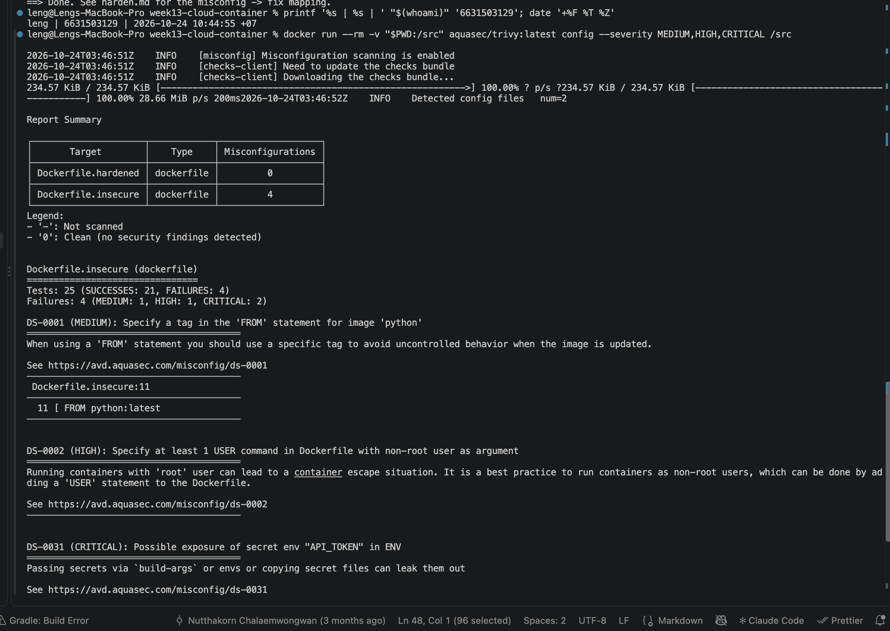
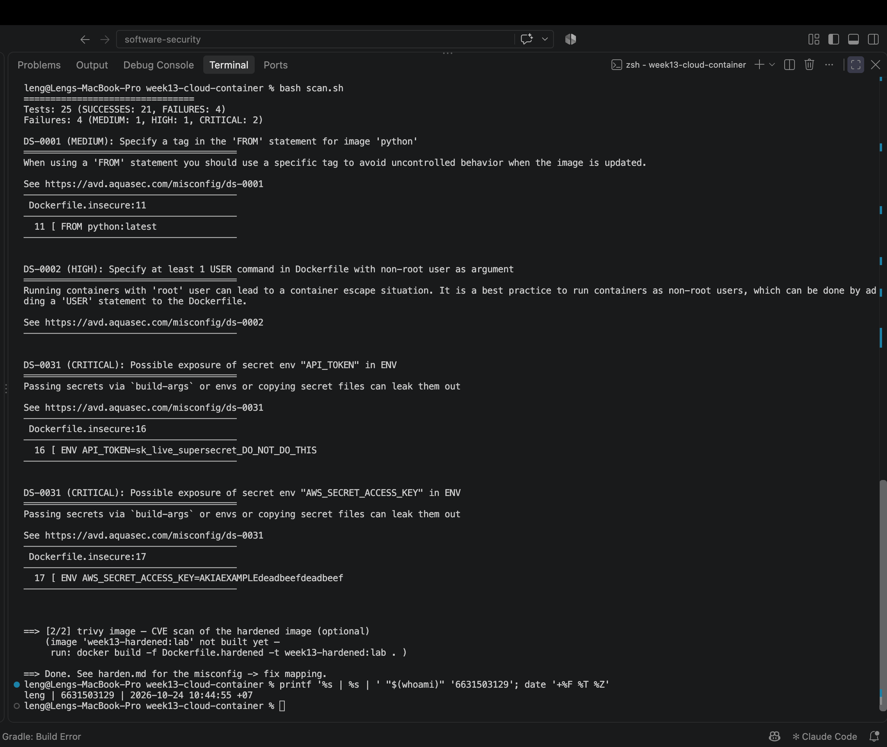

# Worksheet 13 — Cloud & Container Security (4 hrs)

> **Course:** Software Security (KOSEN69) · Week 13
> **Aligned to:** OWASP 2025 **A02 Security Misconfiguration** · **CWE-732** (incorrect permission assignment), **CWE-16** (configuration), plus CWE-798, CWE-250, CWE-538, CWE-269, CWE-1104
> **Signature game:** 🔍 *Misconfig Hunt* (CloudGoat-style) — each misconfig you find **and** fix = a flag.

> ⚠️ **Ethics note:** All artifacts here are deliberately broken for teaching and are marked *"Sandbox/teaching only; for authorized lab use."* Scan, exploit, and harden **only** these lab files (or systems you own / are authorized to test). Never point Trivy or these techniques at third-party cloud accounts or images without written permission.

---

## Part 1 — Student Information

| Name | Student ID | Date | Group | AI-use disclosure |
|------|-----------|------|-------|-------------------|
| Sai Shang Hlang | 6631503129 | 24 Oct 2026 | - | I used Codex to help audit the supplied Dockerfile and IAM policy, structure the answers, and check the hardened artifacts. I reviewed the output against the source and identity-stamped Trivy evidence; I also corrected the non-exact dependency constraint and added the missing `.dockerignore`. |

---

## Part 2 — Lecture Questions

Answer in your own words (2–4 sentences each).

1. Explain the **shared-responsibility model**. In `harden.md` it says "the cloud provider secures *of* the cloud; you secure what you put *in* it." Give one concrete example of each side for an S3-backed app.
   - The provider protects the physical data centres, disks, network fabric, and the S3 service itself. I remain responsible for how my app uses S3: for example, I must keep the bucket private and give the app role only `s3:GetObject` on its required prefix. AWS securing its infrastructure does not correct my public bucket or over-permissive IAM policy.
2. `iam-policy-insecure.json` uses `"Action": "*"` and `"Resource": "*"`. Describe **why this violates least privilege** and map it to CWE-732 vs CWE-269 — what is the difference between the two CWEs here?
   - `Action: "*"` gives the principal every API capability, including unrelated administrative operations, so it is improper privilege management (CWE-269). `Resource: "*"` applies those permissions to every resource instead of the required bucket objects, which is an incorrect permission assignment (CWE-732). The first problem is *what operations* the identity may perform; the second is *where* it may perform them.
3. The insecure Dockerfile bakes `ENV API_TOKEN=sk_live_...`. Explain how an attacker recovers that secret from a shipped image (name the `docker` commands) and why this is **CWE-798 / CWE-200**.
   - Anyone who can pull the image can run `docker history --no-trunc IMAGE` to inspect build instructions and `docker inspect IMAGE` (or format `.Config.Env`) to read its configured environment. The credential is permanently embedded in image metadata/layers, making it a hard-coded credential (CWE-798) and exposing sensitive information to image recipients (CWE-200); deleting it in a later layer would not remove it from earlier layers.
4. Why is `FROM python:latest` (CWE-1104/CWE-16) a security and reproducibility problem, and how does pinning to an `@sha256:` digest fix it?
   - `latest` is a mutable label, so identical source can silently build from different contents tomorrow, including unexpected packages or regressions. A digest identifies one immutable manifest, making builds repeatable and preventing tag movement from changing the base unnoticed. The digest must still be refreshed deliberately after vulnerability testing, because pinning does not provide security updates by itself.
5. What does a **distroless** base image remove (relative to `python:3.11-slim`), and how does that shrink the attack surface for an RCE or container-escape attacker?
   - A distroless runtime normally omits a shell, package manager, compiler, headers, and general command-line utilities, retaining only the interpreter and runtime libraries the application needs. This removes tools an RCE attacker could use for discovery or downloading payloads and reduces the number of packages that can contain CVEs. It limits impact but does not replace non-root execution, kernel isolation, or least privilege.

---

## Part 3 — Hands-on Lab (180 min)

**Learning goals:** find cloud/container misconfigurations with Trivy, map each to a CWE, and rebuild the IAM policy + Dockerfile to least privilege / hardened so the findings drop.

**Prerequisites:** Docker installed and running; the `week13-cloud-container/` lab folder; internet access to pull `aquasec/trivy:latest`.

### Environment setup (real commands)

```bash
cd labs/week13-cloud-container

# Option A — the provided wrapper (trivy config over the Dockerfiles; IAM JSON is reviewed manually, see Task 2):
bash scan.sh

# Option B — run Trivy directly (MEDIUM is in the filter on purpose: one of the
# three rules Task 1 asks you to cite is rated MEDIUM, and HIGH,CRITICAL hides it):
docker run --rm -v "$PWD:/src" aquasec/trivy:latest config --severity MEDIUM,HIGH,CRITICAL /src

# (Optional) build + CVE-scan the hardened image:
docker build -f Dockerfile.hardened -t week13-hardened:lab .
docker run --rm -v /var/run/docker.sock:/var/run/docker.sock aquasec/trivy:latest image --severity HIGH,CRITICAL week13-hardened:lab
```

**What to submit per task:** the command(s) you ran + the relevant output (finding count or the specific finding line), a screenshot of the Trivy/terminal result, and a 2–3 sentence mitigation explaining *why* the fix reduces risk (cite the CWE).




### Tasks

- **Task 0 — Onboarding (15 min).** Confirm Docker works (`docker version`), run `bash scan.sh`, and record the **baseline finding count** against `Dockerfile.insecure` (Trivy's `config` scanner does not parse standalone IAM policy JSON, so `iam-policy-insecure.json` is reviewed manually instead — see Task 2). **Deliverable:** screenshot of the baseline scan.


**Answer / verified result:** Docker client and server version `29.9.2` are available. I ran `bash scan.sh` and the equivalent direct command shown in the first screenshot:

```bash
docker run --rm -v "$PWD:/src" aquasec/trivy:latest config --severity MEDIUM,HIGH,CRITICAL /src
```

Trivy detected two Dockerfiles. `Dockerfile.insecure` has **4 findings** — `MEDIUM: 1`, `HIGH: 1`, `CRITICAL: 2` — while `Dockerfile.hardened` has **0**. There are four scanner findings rather than three because DS-0031 fires once for each of the two secret environment variables.

- **Task 1 — Misconfig Hunt: container image (40 min).** *Goal:* find every defect in `Dockerfile.insecure`. *Steps:* read each `# DEFECT:` comment, then locate the matching Trivy finding where one exists — only 3 of the 6 (unpinned `:latest`, runs as root, secrets in `ENV`) map to a Trivy config rule (`DS-0001`, `DS-0002`, `DS-0031`); `COPY . .`, `chmod -R 777`, and unpinned `pip install` are instruction-level RUN/COPY semantics Trivy's Dockerfile scanner doesn't check, so identify those 3 by code review instead. Build a table: defect → CWE → Trivy rule/severity (write "manual review — no Trivy rule" where none exists). *Deliverable:* completed table (6 rows) using the IDs from `harden.md`.

| Defect in `Dockerfile.insecure` | CWE | Trivy rule / severity | Why it matters |
|---|---|---|---|
| `FROM python:latest` | CWE-1104 / CWE-16 | DS-0001 / MEDIUM | A mutable base makes builds uncontrolled and non-reproducible. |
| Secrets in `ENV` (lines 16–17) | CWE-798 / CWE-200 | DS-0031 / CRITICAL (two findings) | Every image recipient can recover both credentials. |
| `COPY . .` | CWE-538 | Manual review — no Trivy rule | It may copy `.env`, `.git`, keys, and other unnecessary data. |
| Unpinned `pip install` | CWE-1104 | Manual review — no Trivy rule | A later resolution may install different or vulnerable dependencies. |
| `chmod -R 777 /app` | CWE-732 | Manual review — no Trivy rule | Any local process can modify application code or data. |
| No `USER` directive (root default) | CWE-250 | DS-0002 / HIGH | An RCE starts with UID 0 and has a larger impact if isolation fails. |

**Mitigation:** the hardened build uses digest-pinned bases, an exactly pinned dependency, an allowlist of copied files, safe default permissions, a non-root UID, and no embedded credentials. These controls remove the three Trivy rule violations and also address the three instruction-level risks that require human review.

- **Task 2 — Misconfig Hunt: IAM (30 min).** *Goal:* document why `iam-policy-insecure.json` is full-admin. *Steps:* identify the `Action:*` / `Resource:*` / no-`Condition` problems; map to CWE-269 / CWE-732. *Deliverable:* 3-row table + one sentence on the blast radius if these creds leak.

| IAM problem | CWE | Least-privilege fix |
|---|---|---|
| `"Action": "*"` | CWE-269 | Enumerate only `s3:GetObject` and the narrowly needed `s3:ListBucket`. |
| `"Resource": "*"` | CWE-732 | Scope object reads to `arn:aws:s3:::lab-app-bucket/app/*` and listing to the one bucket ARN. |
| No `Condition` | CWE-732 | Add `StringLike` on `s3:prefix` so listing is limited to `app/*`. |

If these credentials leak, an attacker inherits unrestricted actions over all resources the account can reach, so one application compromise can become account-wide theft, modification, deletion, or persistence.

- **Task 3 — Secrets & storage (25 min).** *Goal:* show secrets must not live in the image. *Steps:* explain how `ENV API_TOKEN` / `AWS_SECRET_ACCESS_KEY` are exposed via `docker history`; propose where they belong instead (secrets manager / mounted secret / orchestrator secret per `harden.md`). *Deliverable:* 2–3 sentence remediation + the `.dockerignore` entries you would add to stop `COPY . .` leaking `.git`/`.env` (CWE-538).

**Answer:** `docker history --no-trunc week13-insecure:lab` exposes the secret-bearing build instruction, while `docker inspect --format '{{json .Config.Env}}' week13-insecure:lab` exposes the final environment values. I removed secrets from the Dockerfile; production should fetch them at runtime through a cloud secrets manager or mount them as an orchestrator secret, with a narrowly scoped workload identity. Any demonstrated values must also be revoked and rotated because removing them from a new image does not invalidate an already leaked credential (CWE-798/CWE-200).

The new `.dockerignore` excludes at least the following paths before Docker receives the build context (CWE-538):

```dockerignore
.git
.env
.env.*
*.pem
*.key
.venv/
venv/
node_modules/
```

- **Task 4 — Hardened-Dockerfile + least-priv-IAM defense (50 min).** *Goal:* prove the "after" is clean. *Steps:* (a) re-run `bash scan.sh` (or `trivy config`) against `Dockerfile.hardened` and capture the **reduced** finding count (Trivy's config scanner does not parse standalone IAM JSON, so confirm the IAM fix manually per Task 2 by diffing `iam-policy-leastpriv.json` against the insecure policy); (b) for the Dockerfile, point to the fix for each Task-1 defect (digest pin, multi-stage venv, distroless runtime, `USER 65532:65532`, no secrets in `ENV`, copy only `app.py`); (c) for IAM, confirm the rewrite scopes `s3:GetObject` to `arn:aws:s3:::lab-app-bucket/app/*` and adds the `s3:prefix` `Condition`; (d) list the extra runtime flags from `harden.md` (`--read-only`, `--cap-drop ALL`, `--security-opt no-new-privileges`). *Deliverable:* before/after finding counts, the defect→fix mapping, and the diffed policy/Dockerfile with one sentence per fix.

**Before/after:** `Dockerfile.insecure`: **4** findings; `Dockerfile.hardened`: **0** findings. This is a reduction of four scanner findings, while the three manual Dockerfile defects and three IAM defects were checked by source review.

The hardened image also built successfully as `week13-hardened:lab`. Under `--read-only --cap-drop ALL --security-opt no-new-privileges`, its Flask test client returned `200 {'status': 'healthy'}`; image inspection confirmed `User=65532:65532`, and a full-history search returned no `sk_live_` or `AKIA` value.

| Before | After | Security effect |
|---|---|---|
| `FROM python:latest` | Both stages use explicit `@sha256:` digests | Prevents a mutable tag from silently changing the base (CWE-1104/CWE-16). |
| Full Python runtime | Multi-stage build + distroless runtime | Keeps build tools, shell, and package manager out of production. |
| Secrets in `ENV` | No secret values in the image | Runtime secret injection prevents image metadata/layer disclosure (CWE-798/CWE-200). |
| `COPY . .` | Copy only `requirements.txt`, `app.py`, and the built venv; use `.dockerignore` | Stops unrelated repository data entering the image (CWE-538). |
| `chmod -R 777 /app` | No world-writable permission change | Prevents arbitrary processes from modifying application resources (CWE-732). |
| Root default | `USER 65532:65532` | Limits post-RCE privilege and damage (CWE-250). |
| `Flask>=3.1.3` | `Flask==3.1.3` installed in the build-stage venv | Makes the direct dependency version exact; a generated hash-locked transitive dependency file would strengthen reproducibility further (CWE-1104). |
| IAM `Action: "*"` | `s3:GetObject` plus only required `s3:ListBucket` | Removes unrelated administrative powers (CWE-269). |
| IAM `Resource: "*"` | Object prefix ARN and one bucket ARN | Restricts access to the app's own data (CWE-732). |
| No IAM condition | `s3:prefix` is `app/*` for listing | Prevents enumeration outside the allowed prefix (CWE-732). |

Manual policy comparison confirms `s3:GetObject` is restricted to `arn:aws:s3:::lab-app-bucket/app/*`, and the separate bucket-list statement has a `StringLike` condition for `app/*`. I would run the container with another defense layer:

```bash
docker run --read-only --cap-drop ALL --security-opt no-new-privileges \
  --memory 256m --pids-limit 100 week13-hardened:lab
```

- **Task 5 — Flag tally (20 min).** *Goal:* score the hunt. *Steps:* one flag per misconfig found **and** fixed (6 container + 3 IAM = 9). *Deliverable:* flag count + the single biggest-risk misconfig and why.

**Flag tally: 9/9** — six container defects and three IAM defects were found and fixed. The largest risk is the combination of `Action: "*"` and `Resource: "*"`: if the identity is stolen through the app or its baked AWS key, the attacker receives effectively account-wide capabilities rather than access to one read-only prefix.

---

## Part 4 — Reflection

1. **Mapping.** For three findings, write the line of the artifact → CWE → OWASP 2025 A02, and the one-line fix.
   - `Dockerfile.insecure:11` — `FROM python:latest` → CWE-1104/CWE-16 → OWASP 2025 A02. Fix: use a tested base image pinned by immutable digest.
   - `Dockerfile.insecure:16` — `ENV API_TOKEN=...` → CWE-798/CWE-200 → OWASP 2025 A02. Fix: remove the value and inject a mounted/runtime secret using workload identity.
   - `iam-policy-insecure.json:8-9` — `Action: "*"`, `Resource: "*"` → CWE-269/CWE-732 → OWASP 2025 A02. Fix: allow only the necessary S3 actions on the one bucket and `app/*` prefix, with a condition.
2. **Real incident.** Briefly describe a real breach caused by a cloud/container misconfiguration (e.g., a public S3 bucket leak, or an over-permissive IAM role). What single control from this lab would have prevented it?
   - In the 2019 Capital One breach, an attacker exploited a misconfigured web application firewall, obtained the WAF role's credentials, listed cloud-storage buckets, and copied application data; Capital One reported about 100 million affected people in the US and 6 million in Canada. The single lab control with the most direct effect would be a least-privilege IAM role restricted to only the exact required bucket prefix and operations, preventing a compromised web role from listing and synchronizing broad stores. Sources: [US Department of Justice](https://www.justice.gov/usao-wdwa/pr/seattle-tech-worker-arrested-data-theft-involving-large-financial-services-company), [Capital One incident notice](https://www.capitalone.com/about/newsroom/capital-one-announces-data-security-incident/).
3. **Best mitigation.** Of everything you did, which control gives the most risk reduction per unit of effort, and why? Argue for least-privilege IAM vs. distroless+non-root.
   - Least-privilege IAM gives the greatest risk reduction per unit of effort because it limits the reachable data and operations even when an application credential is stolen. Distroless plus non-root is still valuable because it makes code execution harder to expand inside the container, but it cannot stop valid cloud API calls made with an over-powered role. I would use both; if forced to prioritize one, I would first scope the role to the one bucket prefix and read-only actions because that directly caps cloud-wide blast radius.

---

## Grading rubric (100)

| Component | Points | What earns full marks |
|-----------|:------:|-----------------------|
| Part 2 — Lecture questions | 20 | All 5 answered correctly with CWE/A02 reasoning |
| Part 3 — Tasks + evidence | 40 | Tasks 0–5 complete; commands, outputs, and screenshots present |
| Defense (Task 4 hardening) | 25 | Hardened Dockerfile + least-priv IAM shown to reduce findings; per-fix justification |
| Part 4 — Reflection | 15 | Accurate mapping, relevant incident, well-argued best mitigation |

---

## Evidence & Integrity (required)

- **Identity proof:** every screenshot/diagram must show a terminal running `printf '%s | %s | ' "$(whoami)" '<YOUR-STUDENT-ID>'; date '+%F %T %Z'` **in the
  same image as the evidence**. When the evidence is a browser page, a DevTools panel or a
  rendered response, put that terminal **beside the browser and capture the whole screen** — a
  cropped window carries nothing that identifies you, and the lab's own output is
  byte-identical for the whole cohort *by design*, so the stamp is the only thing that makes
  the shot yours. Generic or borrowed evidence is not accepted.
- **Personalized flag (if this lab issues one):** N/A — this lab uses the 9/9 local misconfiguration tally and did not issue a separate server flag.
  *Flags are unique per student — submitting another student's flag is a violation. How to submit: **learn.zcr.ai/submit** (full guide: `SUBMISSION.md` in the repo root).*
- **Explain in your own words** *(graded on your reasoning, not copied text):*
  1. What did you do, and **why did the vulnerability work**?
     - I scanned both Dockerfiles, manually reviewed the scanner blind spots and IAM JSON, then compared the insecure artifacts with their least-privilege replacements. The vulnerability worked because secrets and excess files were shipped inside the image, processes ran with unnecessary privilege, and the IAM identity had unrestricted actions and resources.
  2. **Why does your fix actually stop it** — and what could still break it?
     - Digest pins, selective copies, runtime secret injection, safe permissions, non-root execution, and resource-scoped IAM remove the specific paths used by the lab. Risk remains if pinned components become vulnerable, a runtime secret is granted too broadly, the host kernel/container engine is compromised, or future policy changes reintroduce privilege, so scanning and policy review must continue in CI.

---

## 🤖 Audit the AI (required)

AI is a power tool you must **distrust** — you are graded on your *critique*, not the AI's answer.

1. Ask an AI assistant to exploit **or** fix this week's vulnerability. Paste its full answer.
2. **Find what's wrong or risky** in it — insecure code, a subtly incomplete fix, a hallucinated API/function/CVE, a missed edge case, or wrong reasoning. Quote the exact line(s).
3. Produce the **correct, verified** version yourself and explain in 2–3 sentences why the AI's output was insufficient.

> Disclose your AI use in the Part 1 table. This task counts toward your **Defense + Reflection** score.

**Prompt I gave the AI:** “Give me a short fix for the secrets, mutable base, and root-user problems in this Dockerfile.”

**Full AI answer:**

> Replace `FROM python:latest` with `FROM python:3.11-slim`, pass the token as a build argument with `ARG API_TOKEN`, and set it using `ENV API_TOKEN=$API_TOKEN`. Add `USER nobody` before the command. This pins Python, keeps the token out of source control, and prevents the application from running as root.

**What is wrong/risky:** the exact lines `FROM python:3.11-slim` and “This pins Python” are wrong because a tag is still mutable; only an immutable digest pins the base contents. More seriously, `ARG API_TOKEN` followed by `ENV API_TOKEN=$API_TOKEN` still records the secret in image history/config, so “keeps the token out of source control” does not make it safe to ship. `USER nobody` can also break file access unless ownership and numeric UID behavior are designed and tested, and the answer misses `COPY . .`, mode `777`, dependency locking, and the oversized runtime.

**Correct, verified version:** `Dockerfile.hardened` uses digest-pinned build and distroless runtime stages, copies only the venv and `app.py`, contains no secret value, and ends with `USER 65532:65532`; `.dockerignore` excludes local secrets and metadata, while `requirements.txt` now uses an exact direct pin. My Trivy result shows the hardened Dockerfile at **0 findings** versus **4** for the insecure file; this is stronger than the AI answer because it addresses every planted defect rather than only changing their surface syntax.

---

## 🧠 Comprehension & Prompt (required)

**A. Explain in Plain English (EiPE).** In 2–3 sentences, in your own words, describe what this week's vulnerable code/endpoint actually *does* and *why it is exploitable* — explain the mechanism, don't dump jargon.

The insecure Docker image bundles credentials and unnecessary repository files, runs the app as root, and gives its cloud identity permission to do anything anywhere. Anyone who receives the image can read the credentials, and one bug in the app can therefore turn into root-level container access and account-wide cloud access.

**B. Prompt Problem.** Write a **single prompt** that makes an AI produce a *correct, secure* fix for one finding. Run it: does the exploit now fail? If not, refine the prompt and try again. Submit the **final prompt + the verified result**.
*Graded on the prompt's precision and your verification — this trains problem decomposition and AI literacy (Denny et al. 2024).*

**Final prompt:**

> Harden `Dockerfile.insecure` for this Python 3.11 Flask lab. Return a complete multi-stage Dockerfile that (1) pins every base with an immutable `@sha256` digest, (2) builds an exactly pinned dependency in `/venv`, (3) uses a Python 3.11 distroless runtime with no shell/package manager, (4) copies only `/venv` and `app.py`, (5) contains no application secret in `ARG`, `ENV`, or any layer, and (6) runs as numeric UID:GID `65532:65532`. Also return a `.dockerignore` excluding `.git`, `.env*`, private-key formats, virtual environments, and `node_modules`. Explain how to inject secrets at runtime and give verification commands for Trivy, `docker history`, and `docker inspect`; do not claim success unless their outputs prove zero MEDIUM/HIGH/CRITICAL configuration findings and no embedded secret values.

**Verified result:** the generated design matches `Dockerfile.hardened` and the new `.dockerignore`, and `docker build -f Dockerfile.hardened -t week13-hardened:lab .` completed successfully. The identity-stamped Trivy output reports **0** misconfigurations for the hardened Dockerfile; `docker history --no-trunc week13-hardened:lab | grep -E 'sk_live_|AKIA'` returned no matches, while `docker inspect` showed only runtime paths/certificate/locale variables and `User=65532:65532`. Finally, the app returned HTTP 200 from `/health` while running with a read-only filesystem, all capabilities dropped, and `no-new-privileges`, so the secure build remains functional.
