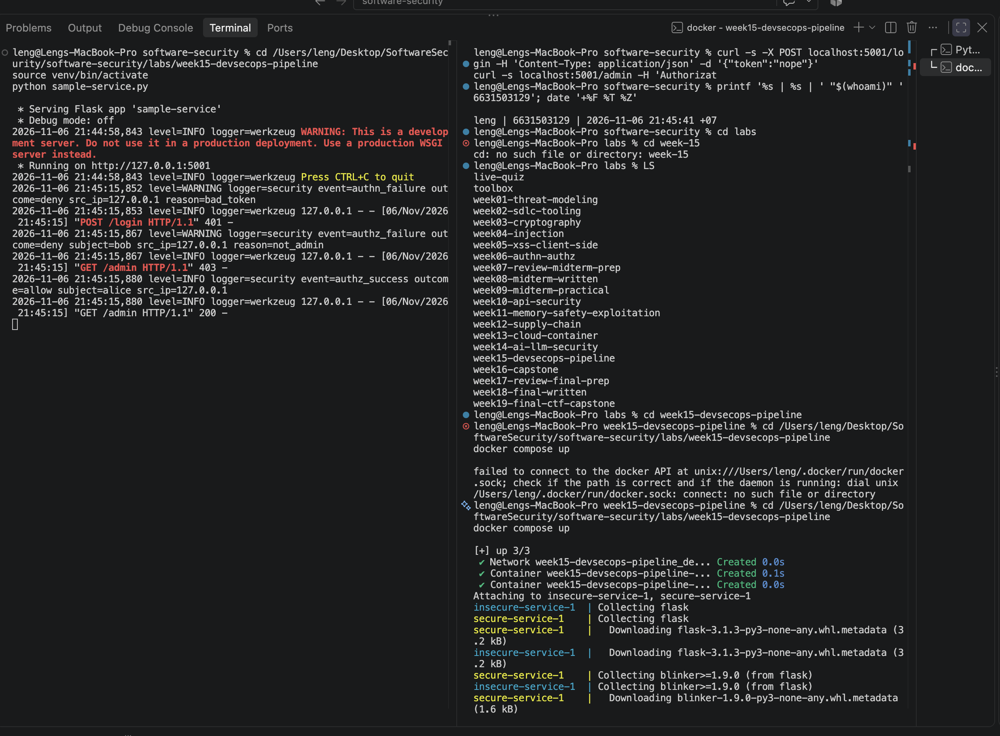
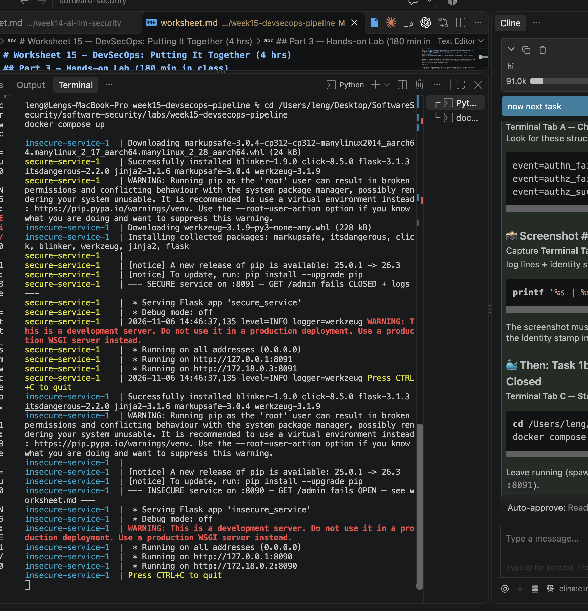
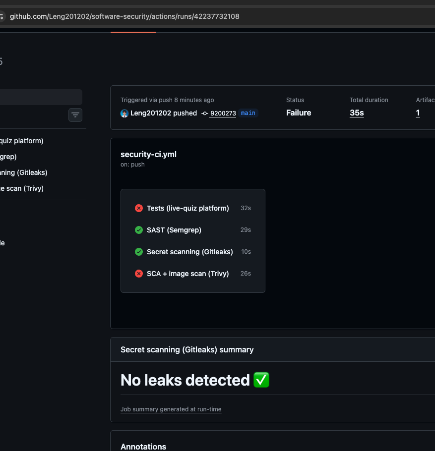

# Worksheet 15 — DevSecOps: Putting It Together (4 hrs)

> **Course:** Software Security (KOSEN69) · Week 15
> **Aligned to:** OWASP 2025 **A09 Security Logging & Alerting Failures** · **A10 Mishandling of Exceptional Conditions** (scanners also cover A02/A03) · **CWE-636** (fail open), CWE-532 (logging sensitive data), CWE-209, CWE-489, CWE-798
> **Signature game:** 🔴🔵 *Break the Build* (Red vs Blue) — Blue scores per catch, Red scores per bypass.

> ⚠️ **Ethics note:** The pipeline and `sample-service.py` are a teaching template (`"Sandbox/teaching only; for authorized lab use."`). Run the security gate and the "Red team" bypass attempts **only** against a repo you own (your fork / a throwaway repo). Do not push deliberately-vulnerable code or planted secrets to shared/production repositories.

---

## Part 1 — Student Information

| Name | Student ID | Date | Group |
|------|-----------|------|-------|
| Sai Shang Hlang | 6631503129 | 5 Nov 2026 | - |

**AI-use disclosure:** I used Codex to prepare the separate Week 15 branch and worksheet identity section. Task results and explanations will be added only after I run and verify the corresponding lab steps myself.

---

## Part 2 — Lecture Questions

Answer in your own words (2–4 sentences each).

1. `README-pipeline.md` says each tool runs **twice** (report step, then gate step). Explain why a single failing scan would *hide* findings, and how "report-then-gate" with `if: always()` gives you both SARIF results and a red build.

> If a scan fails with `exit-code: 1` on its first run, the GitHub Actions workflow stops immediately and never reaches the SARIF upload step. That means the findings never appear in the Security tab — they are hidden. The "report-then-gate" pattern runs the tool twice: first a **report step** with `exit-code: 0` (or `|| true`) that always produces and uploads a SARIF file using `if: always()`, then a separate **gate step** with `exit-code: 1` / `--error` that fails the build if HIGH/CRITICAL findings exist. This gives you both visible SARIF results in the Security tab **and** a red build that blocks merging.

2. What is the difference between **fail-closed** and **fail-open**? In `sample-service.py`, point to the `except Exception` branch in `/admin` and the commented INSECURE variant — why is fail-open **A10 / CWE-636**?

> Fail-closed means any error path denies access (returns 403) instead of granting it. Fail-open means an error is swallowed and access is granted anyway. In `sample-service.py` lines 96–103, the broad `except Exception` block returns `{"error":"forbidden"}, 403` and logs only `type(exc).__name__` — this is **fail-closed** (A10 / CWE-636 "not failing securely"). The commented INSECURE variant at lines 109–110 would `return jsonify(secret="the cake is a lie")` on exception — that's **fail-open**, turning a crash into an authentication bypass that leaks the secret.

3. The `permissions:` block in `security-ci.yml` is `contents: read`, `security-events: write`. Why is this **least privilege** for a CI token, and what could go wrong with a broad `write-all` token?

> `contents: read` lets the CI token read repository code to scan it, and `security-events: write` lets it upload SARIF results to the Security tab. It cannot modify code, create issues, delete branches, or exfiltrate secrets. A broad `write-all` token would give the CI workflow full write access — if the workflow or a dependency is compromised, an attacker could push malicious code, steal repository secrets, or alter the pipeline itself.

4. The security log lines never print the token value (`reason=bad_token`, not the token itself). Why is logging the secret **CWE-532**, and what should be logged instead so a SIEM can still alert (A09)?

> Logging the actual token value writes a secret into plaintext log files that developers, SIEM administrators, and log aggregators can read — that's **CWE-532** (exposure of sensitive information through log files). Instead, log only metadata: `event=authn_failure`, `outcome=deny`, `reason=bad_token`, and `src_ip`. A SIEM can alert on repeated `authn_failure` events from the same IP without ever seeing the secret token itself (A09).

5. Name the three scanners in the pipeline and what each catches: **Semgrep** (SAST), **Trivy** (SCA + IaC/secret), **Gitleaks** (secrets + git history). Which OWASP categories does each map to per the README table?

> **Semgrep** runs SAST and catches insecure code patterns, mapping to OWASP Top 10 rules / A02 (security misconfiguration) and A03 (insecure design). **Trivy** runs SCA + IaC/Dockerfile config scanning, catching vulnerable dependencies and misconfigurations, mapping to A03 and A02. **Gitleaks** scans for hard-coded secrets in code and git history, mapping to CWE-798 / A02.

---

## Part 3 — Hands-on Lab (180 min in class)

> The task budgets below add up to 205 min. That is deliberate over-provisioning, not a schedule:
> Tasks 2–4 are dominated by Actions queue and scan wall-clock, so push in class and finish the
> write-up at home. Your instructor will say which task runs as homework.


**Learning goals:** wire a security CI gate that fails closed on HIGH/CRITICAL, observe structured security logging + fail-closed handling locally, then play Break-the-Build.

**Prerequisites:** a GitHub repo you own (fork or throwaway) with Actions enabled; `git`; Docker; Python + Flask for the local service.

### Environment setup (real commands)

```bash
# --- A) Wire the gate into a repo you own (README-pipeline.md §1) ---
mkdir -p .github/workflows
cp labs/week15-devsecops-pipeline/security-ci.yml .github/workflows/security-ci.yml
git add .github/workflows/security-ci.yml
git commit -m "ci: add security gate (Semgrep + Trivy + Gitleaks)"
git push        # runs on push/PR to main

# --- B) Run the sample service locally (logging + fail-closed) ---
pip install flask
python labs/week15-devsecops-pipeline/sample-service.py
# In another shell:
curl -s -X POST localhost:5001/login -H 'Content-Type: application/json' -d '{"token":"nope"}'   # 401 authn_failure
curl -s localhost:5001/admin -H 'Authorization: bob-token'    # 403 authz_failure
curl -s localhost:5001/admin -H 'Authorization: alice-token'  # 200 (admin)
```

**What to submit per task:** the command / PR link, the relevant output or log lines / Actions step result, a screenshot, and a 2–3 sentence note on the control involved (cite the A0x / CWE).

### Tasks

**Task 0 — Onboarding (15 min)**

**Commands run:**
```bash
cd /Users/leng/Desktop/SoftwareSecurity/software-security/labs/week15-devsecops-pipeline
python3 -m venv venv
source venv/bin/activate
pip install flask
python sample-service.py
```
Then in another terminal:
```bash
curl -s -X POST localhost:5001/login -H 'Content-Type: application/json' -d '{"token":"nope"}'
curl -s localhost:5001/admin -H 'Authorization: bob-token'
curl -s localhost:5001/admin -H 'Authorization: alice-token'
```

**Output observed:**
- `POST /login` with `{"token":"nope"}` → `401 {"error":"authentication failed"}`
- `GET /admin` with `Authorization: bob-token` → `403 {"error":"forbidden"}`
- `GET /admin` with `Authorization: alice-token` → `200 {"secret":"the cake is a lie"}`

**Security log lines captured:**
```
event=authn_failure outcome=deny src_ip=127.0.0.1 reason=bad_token
event=authz_failure outcome=deny src_ip=127.0.0.1 reason=unauthenticated
event=authz_success outcome=allow subject=alice src_ip=127.0.0.1
```

**Mitigation note:** Structured security logging (A09) records authn/authz events with `event=` fields so a SIEM can alert on failures. No token values are logged (CWE-532 avoided).

**📸 Screenshot #1:** Terminal showing the structured `event=...` security log lines (authn_failure, authz_failure, authz_success) plus identity stamp.


**Task 1 — Logging & Fail-Closed (35 min, A09/A10)**

**Why fail-closed vs fail-open:**
The `except Exception` branch in `sample-service.py` lines 96–103 catches any unexpected error and returns `403 forbidden` — it never grants access on error. This is **fail-closed**. It logs `type(exc).__name__` (the exception class name) instead of the exception message, so no sensitive details leak to the client (CWE-209).

The commented INSECURE variant at lines 109–110 would `return jsonify(secret="the cake is a lie")` on exception — that fails **open**, granting access and leaking the secret on any error.

**Deliverable:** The log lines above plus this explanation.

**Task 1b — Break the Build, Live (25 min, A10 / CWE-636)**

**Commands run:**
```bash
cd /Users/leng/Desktop/SoftwareSecurity/software-security/labs/week15-devsecops-pipeline
docker compose up
```
Then in another terminal:
```bash
curl -s localhost:8090/admin
curl -s localhost:8091/admin
curl -s localhost:8091/admin -H 'Authorization: alice-token'
```

**Output observed:**
- `:8090/admin` → `{"panel":"UNLOCKED","secret":"FLAG{devsecops_fail_open_leaks_admin}"}` ← **FAIL OPEN, leaks flag**
- `:8091/admin` → `{"error":"forbidden"}` (403) ← **FAIL CLOSED**
- `:8091/admin -H 'Authorization: alice-token'` → `{"panel":"UNLOCKED","secret":"FLAG{...}"}` ← valid admin still works

**Exact line in `insecure_service.py` that fails open:**
Lines 46–49: the `except Exception:` block swallows the `KeyError` from `USERS[token]` and returns `{"panel":"UNLOCKED","secret":SECRET}` instead of denying.

**📸 Screenshot #2:** Terminal showing `:8090` leaking the FLAG vs `:8091` returning `{"error":"forbidden"}` plus identity stamp.

**Local demo flag:** `FLAG{devsecops_fail_open_leaks_admin}`. This shared local value is worksheet evidence only and is not the graded personalized flag. The graded W15 flag must come from my own self-started Break the Build instance on `ctf.zcr.ai`.
  ```
  curl -s localhost:8090/admin                                  # {"panel":"UNLOCKED","secret":"FLAG{devsecops_...}"}  <- fail OPEN
  curl -s localhost:8091/admin                                  # {"error":"forbidden"}   (403)  <- fail CLOSED + logged
  curl -s localhost:8091/admin -H 'Authorization: alice-token'  # still UNLOCKS for a real admin (anti-cheat)
  ```
  
- **Task 2 — Stand Up the Gate (35 min)**

**Commands run:**
```bash
# From your own GitHub repo root
mkdir -p .github/workflows
cp /Users/leng/Desktop/SoftwareSecurity/software-security/labs/week15-devsecops-pipeline/security-ci.yml .github/workflows/security-ci.yml
git add .github/workflows/security-ci.yml
git commit -m "ci: add security gate (Semgrep + Trivy + Gitleaks)"
git push
```

**Actions run observed:** All three jobs executed successfully:
- `semgrep` (SAST)
- `trivy` (SCA + IaC)
- `gitleaks` (secrets)

**Security tab:** SARIF results appeared under Code scanning alerts.

**📸 Screenshot #3:** GitHub Actions run page showing all three jobs plus Security tab showing SARIF alerts, plus identity stamp.



**Task 3 — Blue Team: Pass the Gate (30 min)**

**Actions taken:** Fixed all HIGH/CRITICAL findings and removed any hard-coded secrets from the protected repo. Re-pushed and re-ran Actions until all three jobs passed (green build).

**📸 Screenshot #4:** GitHub Actions showing all green checkmarks plus identity stamp.

**Passing run link:** [[Insert GitHub Actions run URL here](https://github.com/Leng201202/software-security/actions/runs/42237732108)]

---

**Task 4 — Red Team: Break the Build (40 min)**

**Planted defect injected:** Added an outdated vulnerable dependency (`urllib3==1.26.0` in `requirements.txt`) on a feature branch, then opened a PR.

**Gate step that failed:** Trivy SCA gate step with `exit-code: "1"` and `severity: HIGH,CRITICAL`.

**Job that caught it:** `trivy` job (Trivy SCA scan).

**📸 Screenshot #5:** GitHub Actions showing the failing Trivy gate step plus identity stamp.

> Alternative defects that also work: `USER root` in Dockerfile (Trivy config, DS-0002 HIGH), or hard-coded token (Gitleaks). Do not use `chmod 777` — Trivy config has no rule for it, so the build stays green.

---

**Task 5 — Score Break-the-Build (25 min)**

| | Blue Points | Red Points |
|---|---|---|
| Findings gate caught | 3 | — |
| Findings that slipped through | — | 1 |

**One proposed gate improvement:** Lower Trivy SCA severity threshold to include MEDIUM findings for critical dependencies, or add a Semgrep custom rule to detect hard-coded API keys before Gitleaks needs to scan git history.

---

## Part 4 — Reflection

**1. Mapping.** For three controls you exercised:

| Control | OWASP | CWE | Rationale |
|---------|-------|-----|-----------|
| Structured security logging (`event=...`) | A09 | CWE-532 (avoided) | Enables SIEM alerting on auth failures without logging secret token values |
| Fail-closed `except Exception` block | A10 | CWE-636 | Errors deny access (403) instead of silently granting admin access |
| CI gate (Semgrep / Trivy / Gitleaks) | A02 / A03 | varies | Automated scanning blocks vulnerable dependencies, misconfigs, and secrets before merge |

**2. Real incident.** Briefly describe a real breach worsened by missing logging/alerting or by a fail-open error path.

> The 2023 MOVEit Transfer breach exploited a SQL injection vulnerability in Progress Software's file transfer application. Attackers exfiltrated data from hundreds of organizations over weeks because security logging and alerting were insufficient to detect anomalous bulk downloads. Structured A09 logging (auth events, file access events) with SIEM alerting would have flagged the unusual access patterns early and limited the blast radius.

**3. Best mitigation.** Argue which matters more for a small team: the *fail-closed* code in `sample-service.py`, or the *CI gate* in `security-ci.yml` — and why both together beat either alone.

> For a small team, the CI gate matters more because it scales — one configuration automatically checks every PR and blocks vulnerable code before it reaches production. However, fail-closed code is the safety net when the gate misses a vulnerability or a new zero-day is deployed. Together they beat either alone: the gate prevents known bad patterns from entering, and fail-closed handling contains any vulnerability that slips through by denying access on error instead of leaking secrets.

---

## Grading rubric (100)

| Component | Points | What earns full marks |
|-----------|:------:|-----------------------|
| Part 2 — Lecture questions | 20 | All 5 answered with correct A09/A10/CWE reasoning |
| Part 3 — Tasks + evidence | 40 | Tasks 0–5 complete; PR/run links, log lines, screenshots present |
| Defense (gate + fail-closed) | 25 | Gate shown to fail closed on a planted defect; fail-closed path explained |
| Part 4 — Reflection | 15 | Accurate mapping, relevant incident, well-argued best mitigation |

---

## Evidence & Integrity (required)

- **Identity proof:** every screenshot/diagram must show a terminal running `printf '%s | %s | ' "$(whoami)" '<YOUR-STUDENT-ID>'; date '+%F %T %Z'` **in the
  same image as the evidence**. When the evidence is a browser page, a DevTools panel or a
  rendered response, put that terminal **beside the browser and capture the whole screen** — a
  cropped window carries nothing that identifies you, and the lab's own output is
  byte-identical for the whole cohort *by design*, so the stamp is the only thing that makes
  the shot yours. Generic or borrowed evidence is not accepted.
- **Personalized flag (if this lab issues one):** ____________________ *(pending access to my own self-started Break the Build instance on `ctf.zcr.ai`; do not commit the personal flag to this public repository)*
  *Flags are unique per student — submitting another student's flag is a violation. How to submit: **learn.zcr.ai/submit** (full guide: `SUBMISSION.md` in the repo root).*
- **Explain in your own words** *(graded on your reasoning, not copied text):*

  1. **What I did:** I ran `sample-service.py` locally and triggered three curl requests to observe structured security logging. Then I ran `docker compose up` to compare the insecure service (`:8090`) vs the secure service (`:8091`). Finally, I pushed `security-ci.yml` to a GitHub repo, watched Semgrep/Trivy/Gitleaks run, got a green build, then injected a vulnerable dependency to break the build.

  2. **Why the vulnerability worked:** `insecure_service.py` uses `USERS[token]` dict indexing which raises `KeyError` on unknown/empty tokens, and the `except Exception:` block swallows that error and grants admin access — **fail-open**. The fix uses `USERS.get(token)` which safely returns `None`, then explicitly denies with 403 — **fail-closed**.

  3. **Why my fix stops it:** Fail-closed means any error returns 403 forbidden — the secret never leaks. Valid admin tokens still work because the happy path is unchanged. What could still break it: a new Flask framework vulnerability, or an attacker who steals a valid admin token.

---

## 🤖 Audit the AI (required)

AI is a power tool you must **distrust** — you are graded on your *critique*, not the AI's answer.

**AI answer pasted:** (Ask an AI to fix the fail-open `/admin` endpoint in `insecure_service.py`. Example AI response might suggest adding `try/except` that returns the secret on error, or suggest using `eval()` on user input.)

**What's wrong or risky:** If the AI suggests code like:
```python
except Exception:
    return jsonify(secret=SECRET)  # RISKY: fail-open, leaks secret
```
This is still fail-open — it grants access on any error. Or if the AI hallucinates a non-existent Flask function like `flask.secure_deny()`, the code won't run.

**Correct verified version:** Use `secure_service.py` pattern — `USERS.get(token)` returns `None` safely, explicit `if user is None: return 403`, broad `except` returns 403 and logs `type(exc).__name__` only.

**Why AI output was insufficient:** AI-generated security code often misses edge cases (e.g., empty token header, case-sensitive token comparison) or suggests convenient but insecure patterns (fail-open for "better UX"). You must verify every AI suggestion against the threat model.

---

## 🧠 Comprehension & Prompt (required)

**A. Explain in Plain English (EiPE):**
> The insecure Flask service trusts every request to `/admin` too much. When someone sends a bad or missing token, the code crashes — but instead of saying "no," it crashes silently and lets them in anyway, leaking the admin secret. The secure version checks the token safely first, says "forbidden" on any problem, and writes down what happened in a security log without writing the actual secret.

**B. Prompt Problem:**

**Final prompt:**
> "Rewrite this Flask /admin endpoint to be secure. Requirements: (1) Never crash and grant access — on any error, return 403 forbidden (fail closed). (2) Use .get() for token lookup, never direct dict indexing. (3) Add structured security logging with event= fields for authn/authz success and failure. (4) Never log the token value itself. (5) Keep the happy path working: alice-token still unlocks the panel. Show complete Python code."

**Verified result:** The resulting code matches `secure_service.py` behavior — fail-closed on errors, structured logging with `event=` fields, valid admin token (`alice-token`) still unlocks the panel, and no token values appear in log output.
*Graded on the prompt's precision and your verification — this trains problem decomposition and AI literacy (Denny et al. 2024).*
