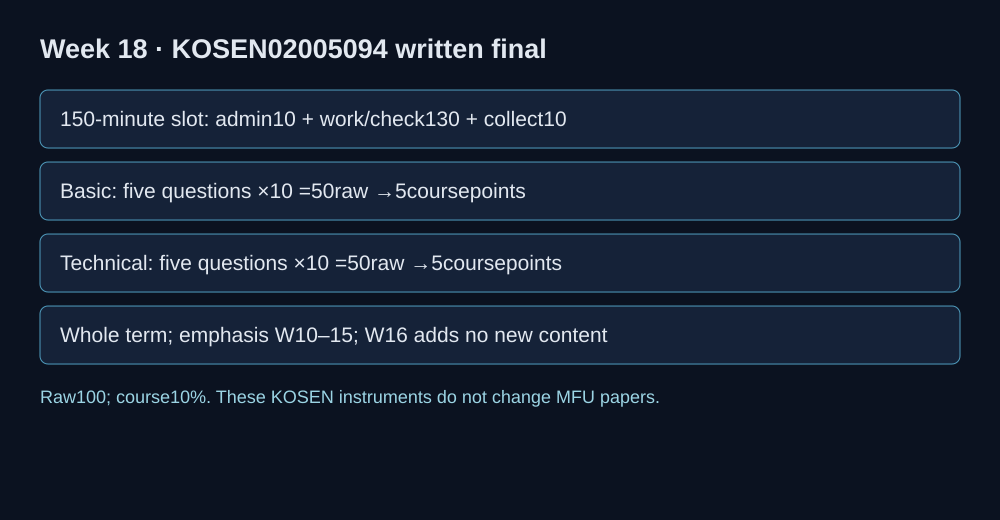

# Final written — current KOSEN specimen A

**Course: Software Security 2 (02005094) · Week 18 · 150-minute class slot: 10 minutes administration + 130 minutes working/checking + 10 minutes collection.**

**Raw 100: Basic 50 + Technical 50. Course weight: 10% (5 Basic + 5 Technical).** Covers the whole term, emphasis Weeks 10–15; Week 16 adds no new examinable content.

Name: __________________ Student ID: ______________ Date: ___________

This public specimen fixes scope and workload. The instructor uses a separate prepared sitting variant. Answer only the ten questions below. Each is 10 raw points, with a suggested 12 minutes (120 minutes total), then use 10 minutes to review within the 130-minute working window. Administrative time is not additional task time. Use your own explanation and the provided sandbox/code only; permitted aids follow the published sitting notice. Precise mechanisms and tested-design reasoning matter more than memorized catalogue IDs.

## 1. B1 · Basic — 10 points, about 12 minutes

Define BOLA and mass assignment, and distinguish caller authentication from an object authorization decision. Give an example of an allowlisted creation field and a forbidden privilege field.

## 2. B2 · Basic — 10 points, about 12 minutes

Explain what canaries, ASLR, NX and PIE each impede. State one benefit and one boundary of a memory-safe language; explain why one fixed ret2win offset is not portable across builds.

## 3. B3 · Basic — 10 points, about 12 minutes

Distinguish an SBOM, a vulnerability scan, a signature and a trusted signing identity. Explain why possession of a signature does not alone establish SLSA compliance or trust in the signer.

## 4. B4 · Basic — 10 points, about 12 minutes

Identify three risks in a root container with an embedded credential and a wildcard IAM policy. Explain what a local static policy checker can show and what still requires cloud/runtime verification.

## 5. B5 · Basic — 10 points, about 12 minutes

Distinguish direct and indirect prompt injection, unsafe HTML output, and excessive tool privilege. State why a model instruction by itself is not an authorization boundary.

## 6. T1 · Technical — 10 points, about 12 minutes

An API permits caller alice to read bob/orders and accepts is_admin in account creation. Write owner/admin authorization and an allowlist excluding privileged fields. Give one legitimate request and one forbidden request for each control.

## 7. T2 · Technical — 10 points, about 12 minutes

A service handles untrusted UTF-8 input. Contrast byte count with Unicode scalar-value count, show safe invalid-input handling, and design a valid-input and malformed-byte test. Explain one remaining resource/security limit.

## 8. T3 · Technical — 10 points, about 12 minutes

A validly signed artifact is presented with the wrong public key. Design verification that pins the trusted key before accepting the cryptographic result. Include valid/trusted, tampered and valid/wrong-key tests; state what an SBOM adds.

## 9. T4 · Technical — 10 points, about 12 minutes

Design least-privilege S3 access that reads only releases/* in bucket course-artifacts and lists only that prefix. Separate object GetObject and bucket ListBucket resources/conditions. Give one allowed and two denied cases and distinguish policy review from a live AWS test.

## 10. T5 · Technical — 10 points, about 12 minutes

A document-fed assistant renders its reply as HTML and calls a privileged tool. A CI service catches authentication exceptions and grants admin. Specify independent output encoding, server tool authorization, fail-closed exception handling and safe audit logging; give positive and negative controls.

The earlier paper is archived in the course source for optional reference. Its former timings/sections/mark allocation do not apply to this specimen.
