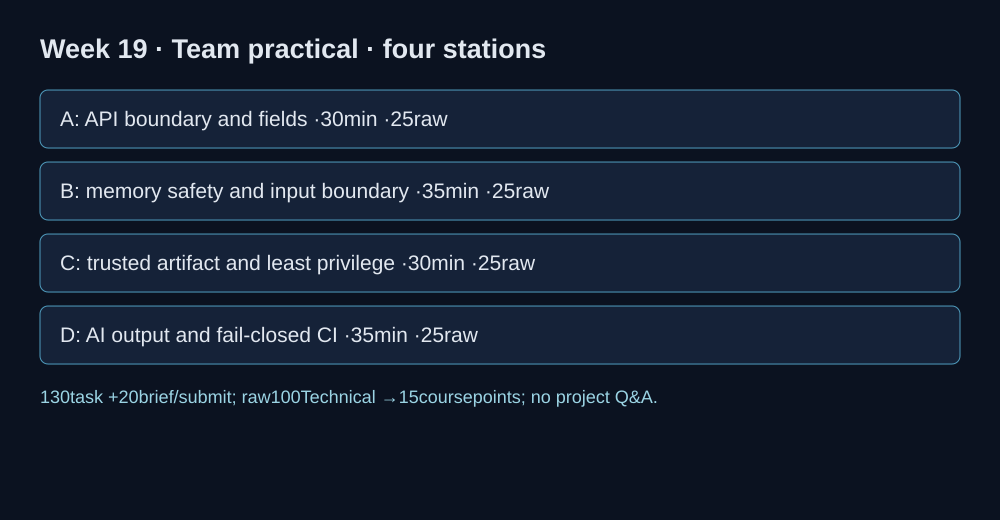

# Final team practical — current KOSEN assessment

**02005094 · Week 19 · 150-minute slot: briefing10 + bounded tasks130 + submission10.**

**Raw 100 · Technical 100 · course contribution 15%. Existing teams of 2–3.** Only the four stations below are required. Course marks use the fixed rubric, independent of CTFd dynamic scores, first-blood, prizes or House XP. A flag alone does not demonstrate correction and cannot earn full academic marks.

The instructor supplies a preflighted local examination pack with the selected starters, data and dependency/runtime instructions. Public weekly labs are practice, not personalized examination evidence; fresh exam flags/instances are not claimed to be deployed. If a supplied hosted instance is used, its proof must come from the assigned instance, but the correction and control evidence below still applies. Never attack an external system.

## Station A — API boundary and field control: 25 raw points, 30 minutes

**Scope:** W10 with W4–6 callback.

Implement owner/admin order authorization and an allowlist of account-creation fields. Demonstrate owner/admin success, cross-user denial and exclusion of a privilege field. Explain why the teaching identity-header assumption is not a production authentication design.

**Submit:** Student code, positive/negative checks and the trust-boundary explanation.

## Station B — Memory safety and input boundary: 25 raw points, 35 minutes

**Scope:** W11.

Use the supplied architecture-compatible starter. Explain the unsafe C copy and build-specific ret2win offset from provided diagnostic evidence; complete the Rust Unicode scalar-value counter and validate the supplied invalid-UTF-8 path. Run valid and invalid-input controls. No exploit construction/fuzzing from scratch is required.

**Submit:** Diagnostic explanation plus student Rust code and both observed controls. The provided C crash trace is an input, not proof that the student ran an exploit.

## Station C — Artifact trust and least privilege: 25 raw points, 30 minutes

**Scope:** W12/W13.

Complete the trusted-public-key fingerprint decision in the prepared local RSA signature fixture. Run trusted-valid, tampered and valid-wrong-key controls; identify the separate authorization decisions in a supplied minimal S3 policy and correct the indicated wildcard. Explain the local fixture/runtime limits.

**Submit:** Student key-pin patch, three verification outcomes, one focused policy diff and scope statement. No registry/OIDC/AWS account is required.

## Station D — AI output boundary and fail-closed CI: 25 raw points, 35 minutes

**Scope:** W14/W15.

Complete secret redaction plus HTML text encoding and fail-closed authorization on a lookup exception. Keep a legitimate request working; reject the secret/XSS or exception case. Record safe audit fields without leaking token/exception text.

**Submit:** Student patches, positive/negative checks and safe log output. No external AI account or hosted jailbreak leaderboard is required.

## Fixed marking and conversion

Each station: root cause and boundary5 + student correction10 + legitimate/negative controls7 + reproducible evidence/limits3 =25. Four stations give raw 100, all Technical. Course contribution = raw/100×15. Record each member's contribution; team2–3 matches existing project grouping. Evidence and reasoning, not flag count, establish partial credit. Leaderboard/first-blood is engagement only.

The project report/code and video of at most 5 minutes are due **before this session** and carry their separate15% rubric. There is no project Q&A inside the130-minute practical. Clarification belongs in Weeks16 and20; the project peer-adjusted raw is capped at 100 before ×0.15.

## Submission

Submit one evidence bundle per student (midterm) or existing team (final): station ID, changed source/diff, exact command, observed result, legitimate positive control, negative control, mechanism and remaining limits. Use the actual sitting assignment announced by the instructor; this update does not silently repurpose historical MFU assignment #16 or change old grades. Verify upload within the final10minutes; no extra task work is scheduled then.

The complete earlier challenge sheet archived in the course source remains an optional practice bank. Its old challenge count, hash-cracking/ECB tasks, raw totals and flag-only submission rule are superseded for this KOSEN sitting.
